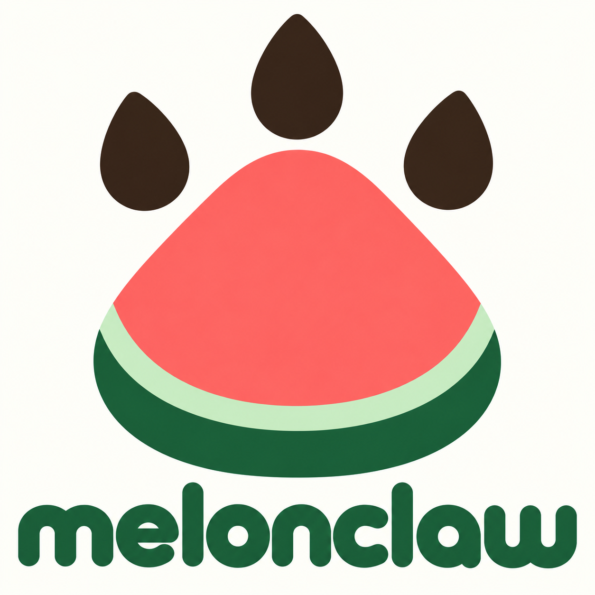
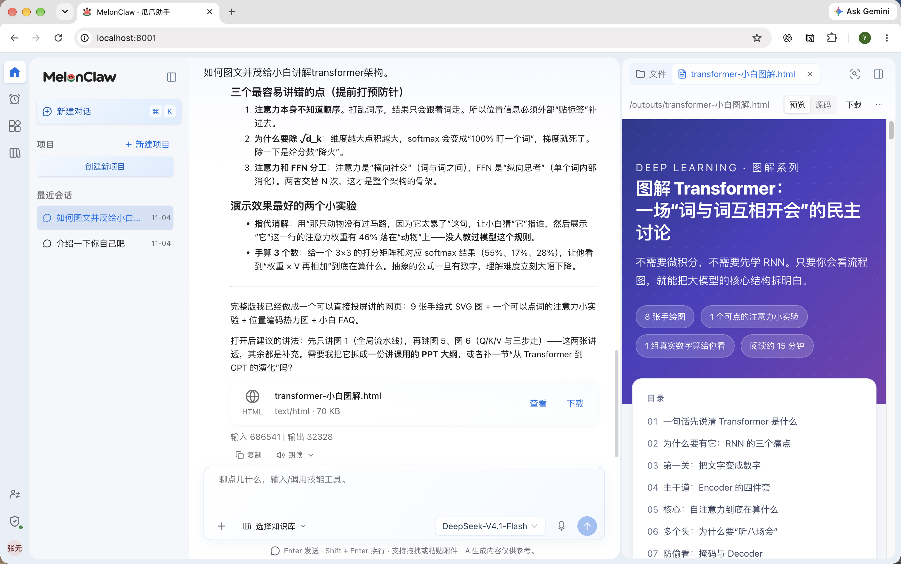

<p align="center">
  
</p>

# MelonClaw

MelonClaw 是基于 Deep Agents 的通用 AI 助手，在一个 Web 界面中完成对话、资料研究、文件处理和多步骤任务。



## 功能与特色

- **多步骤任务**：调用工具和子 Agent，完成资料研究、报告撰写等工作，并查看执行过程。
- **文件与项目**：上传资料、生成并预览文件，同一项目的会话共享工作区。
- **模型与扩展**：自行配置模型，通过 Skill 复用工作流程，通过 MCP 连接外部服务。
- **长期记忆**：跨会话保留信息，延续工作。
- **定时任务**：通过对话或表单设置计划，在固定会话查看结果并追问。

## 本地快速启动

### 准备环境

- Python 3.11+（低于 4.0）与 [uv](https://docs.astral.sh/uv/)。
- Node.js 20+ 与 npm。
- 已启动的 PostgreSQL 14+，以及可连接数据库、创建表的应用账号。
- macOS / Linux；Windows 可使用 WSL。一键启动脚本需要 Bash、`curl`、`lsof`。

### 获取代码

```bash
git clone https://github.com/wangysasd/melonclaw.git
cd melonclaw
```

以下命令均在项目根目录执行。

### 安装依赖

```bash
uv sync --locked
npm --prefix frontend ci

# 仅在没有 .env 时复制，保留已有配置
if [ ! -f .env ]; then cp .env.example .env; fi
```

### 配置文件

创建数据库（见 [PostgreSQL 准备指南](docs/postgresql-setup.md)），在 `.env` 中填写连接地址：

```dotenv
DATABASE_URL=postgresql+asyncpg://<用户>:<密码>@<主机>:<端口>/<数据库名>
```

用户名或密码中的特殊字符需进行 URL 百分号编码，请勿公开连接串。模型在启动后配置。其他选项见[配置说明](docs/configuration.md)。

### 初始化数据库和内置资源

仅在首次使用的数据库上执行：

```bash
uv run melonclaw-resources --service-stopped install-builtins --source .data/skills/shared
uv run melonclaw-db-init
```

资源命令只安装缺失的内置 Skill，不覆盖已有同名资源。初始化创建当前数据库结构、基础配置和管理员 `admin`，初始密码为 `admin`；不会自动清库，也不会创建可用模型。

已有部署请按下方[更新项目](#更新项目)操作。服务启动不会自动建表或升级。

### 启动、关闭和重启服务

```bash
scripts/start.sh     # 启动前后端
scripts/shutdown.sh  # 关闭
scripts/restart.sh   # 重启
```

打开 [http://127.0.0.1:8001](http://127.0.0.1:8001)。后端默认地址为 [http://127.0.0.1:8000](http://127.0.0.1:8000)。

一键脚本默认使用 `dev` 模式，读取 `.env`。分别启动前后端见[手动启动](docs/configuration.md#手动启动)。

### 配置模型

1. 使用 `admin` / `admin` 登录，并修改初始密码。
2. 打开「拓展 → 模型」，配置供应商地址和 API Key，启用供应商，再添加并启用支持工具调用的模型。
3. 新建对话，选择模型，发送“介绍一下你能做什么”。收到回复后，基本链路即已打通。
4. 尝试上传一份资料，发送“总结这份资料，并生成一份 Markdown 文件供我下载”。

聊天前必须配置模型。对话新建定时任务时，如未指定模型，则使用管理员设置的全局系统默认模型。

## 数据保存位置

- **PostgreSQL**：会话记录、长期记忆及模型等业务配置。
- **数据目录**：Skill 等持久资源，默认 `~/.melonclaw/data`。
- **工作区**：会话与项目文件，默认 `~/.melonclaw/workspaces`。

备份时保留数据库和这两个目录。修改目录见[配置说明](docs/configuration.md)。

## 按需扩展

| 功能 | 配置方式 |
|---|---|
| 模型 | 在「拓展 → 模型」管理供应商、模型和凭据 |
| Skill 工作流程 | 在「拓展 → 技能」管理 Skill；脚本依赖与外部客户端需另行准备 |
| 外部数据与服务 | 在「拓展 → 连接器」配置 MCP，启用服务并设置工具白名单 |
| Skill 脚本业务凭据 | 在「拓展 → 环境变量」配置共享或个人变量 |
| 定时任务 | 在「定时任务」创建，或在聊天中说明执行要求与时间 |
| 网页搜索与读取 | 在 `.env` 单独设置 `DEEPSEEK_API_KEY` 并重启；未设置不影响聊天 |
| 调用监控 | 按 [Langfuse 配置](docs/configuration.md#langfuse-追踪)设置环境变量 |

可在聊天中请求安装 Skill 或配置 MCP，预览后需审批。定时任务使用北京时间，Web 服务需保持运行；错过的计划不补跑，上一轮未结束时跳过本次。更多选项见[配置说明](docs/configuration.md)。

## 更新项目

更新项目时，先等待活动任务结束，停止服务并备份数据库、数据目录、工作区和配置，再执行：

```bash
scripts/shutdown.sh
git pull --ff-only
uv sync --locked
npm --prefix frontend ci
uv run melonclaw-db-update
scripts/start.sh
```

不要用数据库初始化命令代替升级。

## 部署与安全边界

- 服务仅支持单实例、单 Web 进程。服务器安装与维护见 [Linux 部署说明](docs/deployment.md)。
- `dev` 模式的身份切换仅用于本机开发，不是生产认证。
- Shell 不是安全沙箱，请勿向不可信用户开放宿主机执行能力。
- 数据库和备份可能包含凭据，应妥善保护。

## 常见问题与反馈

- **忘记管理员密码**：运行 `uv run melonclaw-admin-password` 重置。
- **数据库连接失败**：确认 PostgreSQL 已启动，检查 `.env` 中的 `DATABASE_URL`、数据库是否存在及账号权限。
- **没有可用模型**：在「拓展 → 模型」检查供应商和模型是否启用，以及地址、API Key 是否正确。
- **端口被占用**：先运行 `scripts/shutdown.sh` 关闭本项目服务；若仍被占用，检查占用 8000 或 8001 端口的其他程序。

其他配置与排障说明见[配置说明](docs/configuration.md)。遇到问题或有建议，可到 [GitHub Issues](https://github.com/wangysasd/melonclaw/issues) 反馈；请勿在反馈中包含密码、API Key 或完整数据库连接地址。

## 许可证

本项目采用 [MIT 许可证](LICENSE)。
