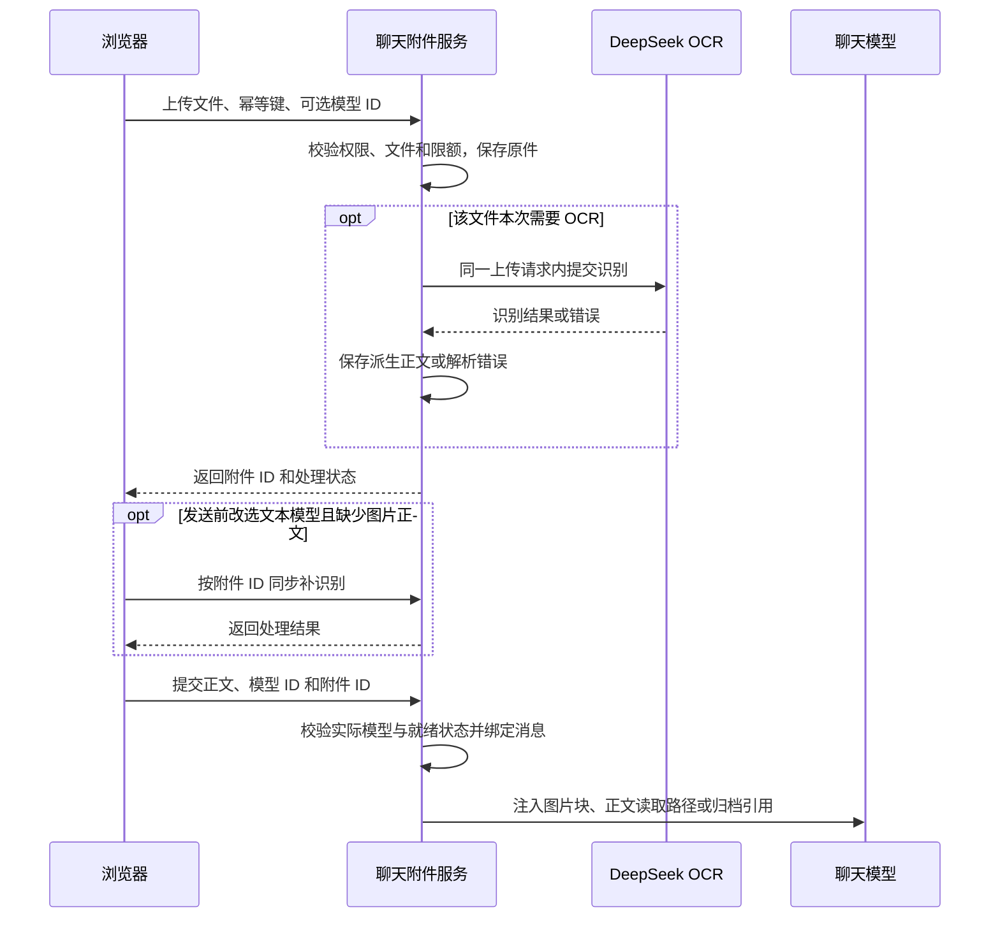

# 普通聊天附件上传与处理

**2026-11-17 · 已实现**

普通会话和项目会话使用同一套附件规则。用户可以上传扫描文档、旧版 Office 和常见图片。附件上传后取得 ID，发送消息时绑定该 ID。模型收到图片或派生正文的读取入口，用户下载时取得上传的原件。 [附件存储、绑定与权限](chat-attachments.md)

## 文件类型与处理

共支持 20 个扩展名。视觉模型指当前实际选中的聊天模型已在 `model_configs.input_modalities` 声明 `image`。表中的 OCR 均使用 DeepSeek 独立的 `/v1/tools/ocr`。

| 文件类型 | 扩展名 | 视觉模型 | 文本模型 |
|---|---|---|---|
| PDF，含扫描版 | `.pdf` | 整份 OCR，`text_recognition` | 同左 |
| Word | `.doc` `.docx` | 整份 OCR，`text_recognition` | 同左 |
| PowerPoint | `.ppt` `.pptx` | 整份 OCR，`text_recognition` | 同左 |
| PNG、JPEG | `.png` `.jpg` `.jpeg` | 用现有图片编码发送 `image_url`，按出站尺寸限制缩放 | 原件 OCR，`rich_layout_recognition` |
| 静态 WebP、GIF、BMP、单页 TIFF | `.webp` `.gif` `.bmp` `.tif` `.tiff` | 本地转 PNG，再发送 `image_url` | 原件 OCR，`rich_layout_recognition` |
| 动画 WebP、GIF | `.webp` `.gif` | 首帧转 PNG，再发送 `image_url` | 首帧转 PNG，再用 `rich_layout_recognition` |
| 多页 TIFF | `.tif` `.tiff` | 保留原页序转成一份 PDF，再用 `rich_layout_recognition` 识别 | 同左 |
| 文本、Markdown | `.txt` `.md` | 本地读取 UTF-8 文本 | 同左 |
| Excel | `.xlsx` | `openpyxl` 本地按工作表读取 | 同左 |
| 旧版 Excel | `.xls` | `xlrd` 本地按工作表读取 | 同左 |
| CSV | `.csv` | 本地解析，生成 Markdown 表格 | 同左 |
| JSON | `.json` | 本地校验结构并格式化 | 同左 |
| Skill 安装包 | `.zip` | 现有归档校验，向 Skill 安装工具提供附件 ID | 同左 |

静态和动画 WebP/GIF 由解码结果区分。动图原件完整保存，处理结果明确标为「使用首帧」。TIFF 的两个后缀采用同一页数判断。单页归为图片，浏览器预览使用 PNG。多页归为文档，服务端临时转为 PDF，确保 DeepSeek 能识别所有页。需要分析多页 TIFF 中某页的图形时，将该页导出为 PNG，再作为图片附件发给视觉模型。 [Pillow 多页 TIFF 文档](https://pillow.readthedocs.io/en/stable/handbook/image-file-formats.html#reading-multi-frame-tiff-images)

通常的 PDF、Word、PPT 和多页 TIFF 在上传后按页生成正文。对 `.xls` 和 `.xlsx` 输出工作表名及单元格值，公式读取文件已保存的计算结果。ZIP 通过现有 Skill 安装链路处理。 [xlrd 文档](https://xlrd.readthedocs.io/en/latest/) · [聊天安装 Skill](chat-skill-install.md)

## 上传与发送

1. **上传时准备。** 普通会话和项目上传入口在 multipart 中接收可选 `model_id`。后端从数据库解析当前用户可用的聊天模型。固定 OCR 的文件始终在上传请求内识别。按模型分流的图片在选中纯文本模型时同步 OCR，选中视觉模型或尚未选定模型时先保存有效图片。文件字节传输完毕后，已知等待 OCR 的条目显示「识别中」。需服务端确定处理路径的条目先显示「处理中」。本地文档使用现有附件解析子进程和就绪状态。
2. **同步 OCR。** 先完成原件校验与暂存，再通过异步 HTTP 客户端等待 DeepSeek 返回。请求等待阶段释放数据库事务。识别和派生文件发布完成后，上传响应为 HTTP 201，附件状态为 `processed`。原件已暂存但识别失败时，同样返回已创建的附件 ID，解析状态为 `failed`，并携带安全的错误分类。界面显示具体原因和可执行的后续操作。原件校验失败走上传错误。上传和重试都在发起 OCR 的请求内取得结果。
3. **切换模型。** 发送或加入队列时一起固定本次模型 ID、附件 ID 和顺序。若图片需要 OCR 且正文尚未准备，发送前用 `POST /api/attachments/{attachment_id}/parse` 同步处理该附件，传入同一模型 ID。优先复用已有结果。改选视觉模型后，从同一原件生成图片块，图片有效时可以发送，即使先前的 OCR 失败。队列实际发出时按该条消息的模型重新核对就绪状态。
4. **绑定与出站。** 服务端以本次解析出的聊天模型和已验证附件决定输入形式，复核用户、当前会话或项目、数量、合计大小和状态后，在现有事务绑定消息与附件。可看图的模式以有效原件为就绪依据。需要读正文的模式以 `processed` 为依据。归档以容器校验完成为依据。将本轮实际使用 OCR 正文的图片 ID 随用户消息的现有 JSON 元数据落库。这样同一张图片可以在不同消息中使用两种表示，已绑定消息的重放沿用当时选择。

模型请求中间件按绑定的表示加载附件。图片只在模型出站请求副本中生成 `image_url`。OCR 和本地文档通过 `/.attachments/<attachment_id>/derived/index.md` 及分片供 `read_file` 按需读取。归档提供文件名和附件 ID。恢复执行时使用已准备的内容，发现原件、正文或实际模型能力已不可用时，返回可见的附件不可用提示。OCR 由上传和显式解析请求触发。

## 校验与限额

DeepSeek 两种 OCR 用途共享单文件 100 MiB、最多 1,000 页的上限。服务端向 DeepSeek 上传的阶段限 120 秒，传输停顿限 30 秒，整次调用限 180 秒。同账号最多同时进行 15 个识别。符合文件和页数限制的任务仍受总时限约束。 [DeepSeek OCR 限制](https://api-docs.deepseek.com/zh-cn/guides/ocr/#限制) · [DeepSeek OCR 并发限制](https://api-docs.deepseek.com/zh-cn/guides/ocr/#限速)

| 校验项 | 生效规则 |
|---|---|
| 聊天附件大小 | 单文件和每条消息合计分别取聊天运行配置。仓库默认单文件 20 MiB、每条消息合计 50 MiB、最多 10 个附件。还须满足当前工作区配额。部署代理的请求体配置覆盖有效单文件上限与 multipart 开销。 |
| OCR 文件大小 | 文件同时满足聊天单文件上限和 DeepSeek 的 100 MiB 上限。发送首帧 PNG 或多页 TIFF 转成的 PDF 时再按实际提交字节数检查。 |
| PDF 页数 | 取聊天配置与 DeepSeek 的 1,000 页上限中较小的值。聊天默认配置下为 500 页。浏览器预检、上传校验与 OCR 结果使用同一数值，识别结果页数须与服务端读出的原件页数一致。 |
| Word、PPT 和多页 TIFF | 可靠可读的页数先检查。Office 的 OCR 结果按 `page_count` 复核。多页 TIFF 从实际解码页数预检，并要求 OCR 返回完整的对应页数。 |
| 图片尺寸 | 服务端做实际格式和像素检查，按配置限制解码与出站尺寸。视觉路径使用模型实际图片能力和现有出站缩放策略。 |

`GET /api/attachments/capabilities` 提供白名单、各处理路径的有效大小和页数，以及消息数量和合计配额。`AttachmentDialog` 用返回值检查实际字节数和剩余可用空间。PDF 在完成类型和大小预检后，按需加载 PDF.js，从本地文件读取 `numPages`。遇到明确损坏、加密或超限，显示对应错误。浏览器读取能力不可用时，由服务端复核。Word 和 PPT 的渲染页数以服务端有效值及 OCR 实际结果为准。 [PDF.js 页数 API](https://mozilla.github.io/pdf.js/api/draft/module-pdfjsLib-PDFDocumentProxy.html#numPages)

服务端统一校验扩展名、声明 MIME、实际文件类型、大小和所属权限。DOC、PPT、XLS 通过旧版 Office 格式的内容校验来区分，文件通过后按表中的方案提取正文。XLSX、DOCX、PPTX 继续使用 OOXML 容器校验。动画需要使用合成后的完整首帧。图片展现与 OCR 分别从可用原件或首帧构建出站内容。所有 OCR 响应都受聊天派生字符上限约束。

## 派生正文、重试与权限

- **完整结果。** DeepSeek 收到 `purpose` 和实际文件。根据请求用途、`page_count`、连续索引和页终止状态验证响应，把从零起的 `index` 转为面向用户的页码。发布按页整理的有效正文时复用附件目录中的临时派生目录和原子发布。识别无字、页缺失、截断、超时、服务繁忙、凭据缺失和本地配额不足各有可解释的错误。多页 TIFF 页数不符时提示重新导出或拆分。 [DeepSeek OCR 响应字段](https://api-docs.deepseek.com/zh-cn/api/ocr/)
- **单次识别与复用。** 上传 `client_request_id` 沿用原有作用域和内容指纹。上传重放和并发解析返回已登记的状态，实际领取本次识别的请求等待 OCR 完成。原件、正文和工作区配额在发布前再次核对，持有该次有效租约的请求发布派生正文后才标记 `processed`。已完成的正文由同一附件直接复用。失效任务收敛到可手动处理的失败状态，读取状态、启动恢复和消息重放只使用本地已有结果。服务端超时或客户端断开后，远端已经接收的请求可能继续识别并计费，用户可以先同步附件状态再决定重试。 [DeepSeek OCR 计费](https://api-docs.deepseek.com/zh-cn/guides/ocr/#计费)
- **失败恢复。** 上传对话框和输入区保留未完成的附件及文字草稿。失败时说明可执行的下一步，如重新识别、拆分文件、移除或改用视觉模型。识别不到文字的普通图片仍可在视觉路径使用。队列在发送前补识别失败时保留原消息，可点「重新识别并发送」。同步 OCR 使用原附件 ID 重试，已附到消息的图片在其授权工作区内也可为新消息补识别。发布失败的临时文件由当前尝试清理。
- **归属和数据。** 租户、用户、会话和项目由服务端解析与复核。原件、派生正文、发送准备、预览和下载使用同一归属规则。`GET /api/attachments/{attachment_id}/content?preview=true` 返回图片预览，下载返回原件。OCR 出站使用部署侧 `DEEPSEEK_API_KEY` 与固定端点，界面明确标明使用 DeepSeek 识别。成功日志记录提交格式、大小、页数和耗时，失败在附件状态中保存安全错误分类。原件和识别文字作为不可信数据，Agent 仅通过当前附件的受控派生路径读正文。消息存储使用原有附件关系和业务元数据。

## 开发接入点

| 位置 | 职责 |
|---|---|
| [附件 API](../../src/melonclaw/api/routes/attachments.py) 和 [附件服务](../../src/melonclaw/services/attachments.py) | 上传、能力清单和 `/parse` 使用同一文件策略。上传与补识别在请求内等待，服务端统一解析可选目录模型 ID。 |
| [校验器](../../src/melonclaw/parsers/validation.py)、[本地文档解析](../../src/melonclaw/parsers/documents.py) 和 [出站图片编码](../../src/melonclaw/services/attachment_images.py) | 按真实格式校验，读取帧或页数，以 `xlrd` 解析 `.xls`，扩展 Pillow 出站 PNG 编码。新图片格式即使尺寸很小，也按表中的输出格式编码。 |
| [聊天 OCR 适配](../../src/melonclaw/services/attachment_ocr.py) 和 [DeepSeek OCR 客户端](../../src/melonclaw/core/knowledge_ocr.py) | 聊天准备 TIFF 和首帧提交内容。复用固定凭据、请求协议、响应校验与错误分类。聊天与知识库分别提供生效的页数、字符数和时限。 |
| [附件仓储](../../src/melonclaw/repository/attachments.py) 和 [附件文件存储](../../src/melonclaw/storage/attachments.py) | 复用既有生命周期、租约、派生目录和绑定事务。多页 TIFF 可归为现有 `document` 类型。帧策略可从原件得出，消息输入表示使用现有 JSON 元数据，表结构沿用当前模型。 |
| [发送准备](../../src/melonclaw/services/execution.py) 和 [附件请求中间件](../../src/melonclaw/middleware/attachment_hydration.py) | 按实际模型复核就绪状态，模型请求只加载本轮绑定的表示。 |
| [附件对话框](../../frontend/src/components/AttachmentDialog.tsx)、[预检工具](../../frontend/src/lib/attachmentFiles.ts) 和 [输入区](../../frontend/src/components/Composer.tsx) | 展示生效限额、识别状态和首帧标记，按模型准备附件和控制发送。 |

## 运行与验证

运行 `uv sync --locked` 和 `npm --prefix frontend ci`，按 README 配置 `DEEPSEEK_API_KEY`、构建前端并启动 Web。附件功能沿用现有数据库结构。可在普通会话上传扫描 PDF，看见「DeepSeek 识别中」和完成状态。用相同图片对照视觉模型和文本模型，检查输入区状态及无文字时的错误反馈。 [README](../../README.md)

- 真实 DeepSeek 接口使用合成 PDF、DOC、DOCX、PPT 和 PPTX 验证 `text_recognition`。使用 PNG、JPEG、WebP、GIF、BMP 和单页 TIFF 验证 `rich_layout_recognition`，动图 WebP/GIF 验证只提交了首帧。双页 TIFF 原样提交时只返回第一页，转 PDF 后用原用途识别出两页，顺序正确。旧 XLS 本地读取验证了两个工作表。
- 隔离 PostgreSQL 验证了同步多页 TIFF、单页 TIFF 预览、并发重试、上传幂等以及同一动图在两条消息中分别使用图片或正文。视觉模型请求使用测试模型，真实视觉效果依赖部署时配置的供应商。
- 浏览器以两页 PDF 验证了实际分页读取和超限拦截。前端回归覆盖上传失败、草稿保留、文本模型补识别和队列重试。

`scripts/check.sh` 和前端生产构建已通过。 [附件实施记录](../exec-plans/completed/2026-11-17-chat-attachment-processing.md)
