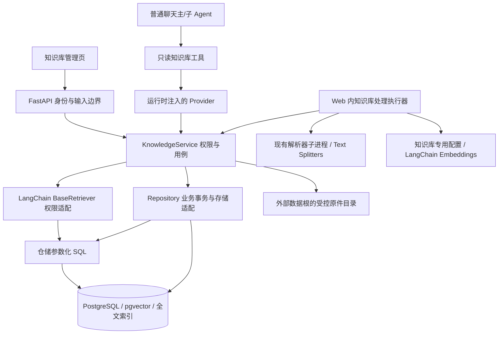

# 知识库阶段设计与验证记录归档

状态：历史归档，非现行契约
归档日期：2026-11-17

本文件保留文档整理前的知识库阶段方案、调研与验证记录，供追溯决策和当时验收范围。下文的“当前”“首版”“未实现”“覆盖前文”等均属于原记录所在阶段，部分方案已被替代，不能据此配置或修改当前系统；新验证也不追加到此快照。

当前能力、配置、权限、导入与检索统一见[知识库设计](../../design-docs/knowledge-base.md)。本次整理未重新执行历史外部 API 验收，也未操作业务数据库。原稿未确认或仅引用本地 note 的检查结果，不因归档而成为已验证事实。

---

# 个人与共享知识库设计

**当前规则（2026-11-09）**

- 检索、检索测试和普通聊天已经接通。输入区选了库之后，三个只读查询工具直接可用，系统消息写明本轮有权访问的库名、类型、id 和描述（每库最多 300 字符）。名称和描述以 JSON 数据呈现并明确标为不可信内容，不改变权限校验；没有选择时不去查。模型按需逐库调用，不保证检索所有选中库。
- 同一知识库同一时间处理一份资料，运行中的取消在实际退出后释放占用。
- 共享在库上三选一：所有人、同租户、指定人。新建库可选择共享范围，默认同租户。同租户按所有者当前租户实时计算。点名的查看者和编辑者可以来自任意有效用户。换租户保留点名授权；删除用户前须先转让或删除其知识库。所有者或其所在租户停用时，普通用户不可访问；系统管理员仍可访问。


### 共享范围设计

状态：已实现。2026-11-10。列表、检索、下载、成员、转让和聊天查询使用这一套范围。已有库升级为指定人，原有成员授权保留。升级步骤是 `20261110_knowledge_share_scope`。

每个知识库属于一个个人，所有者记在 `owner_user_id`。库上不保存租户。共享在库上三选一，决定谁自动成为查看者。编辑者始终另行点名。

| 范围 | 谁可以查看和下载 |
|---|---|
| 所有人 | 任意有效用户。用户 `tenant_status=active`，所在租户 `enabled`。新用户自动包含，不限租户 |
| 同租户 | 当前与所有者属于同一个 `users.tenant_id` 的有效用户。按所有者现在的租户计算，不按授权当时的名单 |
| 指定人 | 只包括被勾选的用户。候选是全部有效用户，不限租户 |

新建库默认「同租户」；创建或编辑选择「指定人」时可搜索并勾选查看者，最多 100 人。已有编辑者保留原角色。没有成员时所有者和系统管理员能访问。不另设「仅自己」。

「同租户」是实时条件。所有者转让给另一个租户的人之后，查看范围改为新所有者的租户。用户自己换租户后，立刻按新租户获得或失去这类查看权。不把租户里的人展开写进 `knowledge_members`。

角色沿用查看者、编辑者、所有者：

- 范围内的人只有查看者能力：列表、详情、预览、检索、聊天引用、下载原件。范围不会把所有人变成编辑者。
- 编辑者写在现有成员表，三种范围下都可以指定，人选来自全部有效用户，可以不在当前查看范围内。
- 「指定人」下，查看者也写在成员表。一个人一行，角色取成员表；没有成员行就没有权限。
- 「所有人」和「同租户」下，范围内的人不必再写查看者行。成员表保留单独授予的查看者和编辑者。

有效角色按这个顺序取：所有者；成员表中的角色；范围赋予的查看者；否则无权。列表、检索、原文、下载和聊天工具使用同一次判断。不可见仍返回不存在。

访问者必须有效且租户启用，库必须是 active。普通用户访问时所有者及其租户也须有效；system/admin 可以访问所有者或其租户停用的活动库。

转让可以交给任意有效用户。同一事务内去掉目标用户的成员行，把原所有者写成编辑者，并更新 `owner_user_id`。库名在新所有者名下仍须唯一。「同租户」立即按新所有者计算。进行中的作业不因转让批量取消，发布时按当时的权限重验。

用户换租户时保留成员表里的点名授权，不整库清空。「同租户」和「所有人」按上面的实时条件重新计算。删除用户前，仍须先转让或删除他拥有的库；删除时去掉他的成员行。已经进入历史对话或已经下载的内容不追回。

创建、编辑和成员管理均展示共享范围卡片；创建和编辑可直接勾选指定查看者，成员管理可继续维护角色。

- 所有人：说明任意有效用户都可以查看和下载原件。
- 同租户：说明与所有者当前租户相同的用户可以查看和下载；所有者更换后范围跟着新所有者。
- 指定人：建库时勾选查看者，编辑权限在成员管理中授予。

所有人、同租户范围下，仍可单独授予查看或编辑权限。改范围需点击保存；改到「指定人」时保留已有成员行，若没有成员，切换后所有者和系统管理员能访问，切换前需要确认。候选和成员接口只返回用户 ID、中文名和租户名，搜索分页，不返回凭据或管理字段。

数据上给 `knowledge_bases` 增加 `share_scope`，取值为 `everyone`、`tenant`、`selected`，非空，默认 `selected`。已有库回填 `selected`，已有成员行保持不变。用保留数据的升级步骤添加列和 `share_scope_changed` 审计值；新库直接按当前 schema 创建。升级前结束知识库作业和定时任务、停止 Web 并备份。服务启动不自动升级。

system 租户的 admin 可以查看、检索和下载所有未删除的活动知识库，可编辑资料、管理配置和成员并删除知识库；所有权转让仍由所有者执行。仍不做单份资料授权，定时任务仍不读取知识库，聊天仍每轮重传所选库并在调用时重验。


### 审查修复（2026-11-10）

账户迁移或删除在现有事务内取消用户拥有库的作业及其在共享库发起的作业。排队作业取消后释放占用，已运行作业等待实际退出后释放；不自动重跑或清理历史。


运行方式：更新后重启 Web，重新构建/刷新前端；该次修复未运行 db-init/db-update；测试使用隔离库和替身；完整结果见[审查修复记录](2026-11-10-knowledge-review-fixes.md)。未修改业务库或调用付费服务，功能验证不等于检索质量验证。

## 1. 目标与首版范围


在现有 MelonClaw 中增加可长期维护、可共享、能被聊天 Agent 检索并引用原文的知识库。一次上传后，可以跨会话使用；聊天附件仍用于当前对话，User/Tenant Memory 仍用于偏好与长期记忆，三者生命周期独立。

首版只完成文档检索库这一条闭环：

1. 任意有效用户创建 `knowledge_mode=vector` 的知识库，默认只有本人可见。
2. 上传现有解析器已支持的文本型文档，查看解析和索引进度，失败可明确重试。
3. 按知识库给同租户用户授予查看、编辑或管理权限，支持撤销。
4. 在知识库页面测试检索；普通聊天每一轮由客户端重传当前所选知识库后再提问。
5. 回答能定位到文档版本和片段，可打开相邻原文；viewer 及以上可以下载自己有权阅读的原件。


知识库复用现有安全校验和 [parsers/documents.py](../../../src/melonclaw/parsers/documents.py)，维护独立类型白名单，不因知识库扩展而自动扩大聊天附件能力。公网 URL、旧 `.doc`、LibreOffice 和 Unstructured 不进入首版依赖。**首版接入 OCR**：扫描 PDF 与图片经知识库专用文档解析配置调用 SiliconFlow VLM OCR（见 7.3、15.6），不引入本地 OCR 权重；原件内容外发第三方已经用户确认。坐标到 offset 的映射、多页调用与页面级质量口径须按 15.6 的实测结论定稿，不在未验证前臆造。

### 1.1 文档类型与来源范围

| 阶段 | 类型 | 处理与边界 |
|---|---|---|
| 首版 | 带文本层的 `.pdf` | 用现有 pypdf 抽取文本；页码目前只写成 Markdown 标题文本，不是结构化字段。无文本层时转 7.3 的 OCR 通道，加密或损坏时明确失败；不把无文本层 PDF 当成空正文发布 |
| 首版 | `.docx`、`.xlsx`、`.pptx` | 复用现有解析器的抽取结果，但现有实现把 docx 段落与表格分段拼接、工作表/幻灯片序号只写在 Markdown 标题里；结构化位置口径见 6.1 与第 15 节。不执行公式、宏或内嵌图片 OCR |
| 首版 | `.txt`、`.md`、`.csv` | 文本直接加载，Markdown 保留标题，CSV 保留表头；编码明确校验，不猜测后静默乱码。CSV 作为文档问答，不替代数据分析 |
| 后续 | 公网 HTTPS URL | 网页正文或受支持文件直链，保存快照、抓取时间与来源；不递归爬站。安全约束见第 8.2 节，首版没有导入入口 |
| 首版 | 扫描 PDF、`.png`、`.jpg`、`.jpeg`、`.tif`、`.tiff` | 走 7.3 的 SiliconFlow VLM OCR 通道。实测 DeepSeek-OCR 支持整份 PDF base64，PaddleOCR-VL-1.5 需逐页图片；TIFF 多帧须单独限制展开体积。输出带 `<|ref|>`／`<|det|>` 版面标记，无置信度，多页行为待验证 |
| 后续 | `.html`、`.htm`、旧 Word `.doc` | HTML 只提取正文并移除脚本；旧 DOC 需受控 LibreOffice。缺协议或组件时明确不支持 |
| 再后续 | JSON、RTF、EPUB 等 | 先确定内容映射与维护价值；JSON 按显式字段加载，不整份任意结构盲目拼接 |

加密且无法解密、损坏、受 DRM 保护、含不允许活动内容的文件明确拒绝；不接收可执行文件或 ZIP 作为知识资料。登录后网页、浏览器交互抓取、付费墙绕过、外部知识库连接器、知识图谱、文件夹级/单文档权限、匿名公开链接和跨租户共享仍在范围外。公网来源只接受 HTTPS，不另开 HTTP。全租户只读共享、定时任务读取知识库、把原件字节存进 PostgreSQL，都不在首版。

已定边界：

- 共享范围是所有人、同租户或指定人，新建默认同租户可查看。viewer 可以下载原件。
- 原件放在外部数据根，解析正文进 PostgreSQL，原件字节不进 BYTEA。
- 首版接入 OCR：扫描 PDF 与图片走知识库专用文档解析配置，原件内容外发 SiliconFlow 已经用户确认；模型、调用粒度与坐标映射按 15.1 的 D11 结论固定，多页覆盖与版面映射仍属未验证项。
- 首版只有普通聊天，而且每一轮都要显式重传所选库。后台任务不自动获得知识库。

## 2. 从 Yuxi 学到什么

### 2.1 核对依据

调研对象是同级 Yuxi 项目的本地工作树，读取时 HEAD 为 `bd07ab4`。下面使用 Yuxi 仓库相对路径说明依据，不将另一仓库的本机路径写入本项目配置。

| Yuxi 来源 | 核对到的设计事实 | 在 MelonClaw 中的处理 |
|---|---|---|
| `docs/mechanisms/knowledge-base.md`、`backend/package/yuxi/knowledge/manager.py` | 管理链路与 Agent 消费链路分开，由 Manager 选择 executor | 保留管理/消费分工，首版只实现 PostgreSQL 检索，不建立多 executor 框架 |
| `backend/server/routers/knowledge_router.py` | 创建、原件上传等管理入口要求管理员；读取/管理还校验库权限 | 改为所有有效用户可创建，所有文档写入口按库角色授权 |
| `backend/package/yuxi/permissions/resource_permission.py` | 共享区分 read/manage，并结合用户、部门、全局范围和角色上限；创建者直接具有 manage | 借鉴集中授权；改为明确库成员角色，不引入当前项目没有的部门树 |
| `backend/package/yuxi/knowledge/base.py`、`backend/package/yuxi/knowledge/implementations/milvus.py` | 上传、解析、索引分阶段，状态条件更新防并发；chunk 存 PG、向量存 Milvus，失败需要补偿 | 保留阶段与条件抢占；正文和向量同存 PG，完整新版本准备好后再发布 |
| `backend/package/yuxi/storage/postgres/models_knowledge.py` | 库、文件、chunk 分层，记录正文与位置 | 保留分层，增加不可变文档版本与有效版本指针 |
| `backend/package/yuxi/agents/toolkits/kbs/tools.py`、`backend/package/yuxi/agents/backends/knowledge_base_backend.py` | 用户可见库与 Agent 选择求交；通过检索、文件搜索、分段原文工具消费；运行上下文保存可见库快照 | 保留选择范围和原文回看；每次实际调用重验权限，快照不作为授权凭证 |

Yuxi 的原件、向量与可选图谱分别依赖 MinIO、Milvus、Neo4j，还使用运行配置缓存。MelonClaw 首版的业务规模尚未确认，建议从 PostgreSQL 与外部数据目录起步，以减少部署组件和跨存储一致性处理。以上是基于本地实现的取舍，不代表对 Yuxi 所有部署形态的判断。

## 3. 总体架构



PostgreSQL 保存库配置、成员权限、文档元数据、解析正文、分块正文、向量、处理任务和审计。原文件字节默认放在 `MELONCLAW_DATA_DIR` 下的受控目录，解析中间文件放临时目录。解析全文不放在发布事务锁住的 revision 行里，见第 6 节。向量读写的单一实现由第 3.3 节的实施前探针决定，探针未通过时留在仓储参数化 SQL；Repository 在一个业务事务中切换当前版本指针。原件文件发布与数据库仍有非原子边界，需要按第 8 节处理。


继续沿用现有单 Web 实例部署边界。不新增 Redis、Milvus、Elasticsearch、Neo4j 或独立 Worker；知识库导入作业有自己的领域记录和执行器，不写入用户定时任务的 `tasks/task_runs/task_operations`。

### 3.1 LangChain 组件选型

| 环节 | 首选组件 | MelonClaw 需要补充的边界 |
|---|---|---|
| 统一资料对象 | `langchain_core.documents.Document` | `page_content` 放正文；metadata 带库/文档/版本 ID、标题、位置，剔除解析器返回的主机路径 |
| 首版文档加载 | 现有 `parsers/documents.py` | 文本 PDF、docx、xlsx、pptx、txt、md、csv 在隔离子进程中解析。子进程不接收模型凭据、服务地址或网络权限 |
| 标题与长度切分 | `MarkdownHeaderTextSplitter` + `RecursiveCharacterTextSplitter` | `strip_headers=False` 保留标题；配置中文分隔符和局部起始位置，表格按行边界保护 |
| 嵌入调用 | `langchain_core.embeddings.Embeddings`，首版适配 `langchain_openai.OpenAIEmbeddings` | 从数据库显式注入模型、地址、凭据与维度，附加预算和结果校验 |
| 向量入库（拟） | 仓储参数化 SQL | 实施前探针结论必须固定单一实现，不留双路径；稳定 chunk ID，写入未发布 revision |
| 语义检索 | 仓储定维余弦 SQL | 注入强制过滤和限额。混合检索不进入首版 |
| 关键词检索 | Repository 参数化全文 SQL | 使用同一有效版本视图、预分词词项和强制范围；词项组合见第 9.2 节 |
| 对外检索接口 | `langchain_core.retrievers.BaseRetriever` / `ainvoke` | 薄适配封装当前身份、选择范围、权限重验与来源映射；内部可以是原生向量库或仓储 SQL |
| 聊天消费 | 现有 Deep Agents + LangChain Tool | 复用本项目 provider 注入；检索结果按不可信资料返回 |


加载与切分使用官方公开接口，Office 和 PDF 文本复用已有解析器，不为首版引入 Unstructured、LibreOffice 或另一套 Loader。OCR、HTML 和 URL 仍是后续适配槽：协议或抓取组件到达后，由服务层把结果规范成 `Document`，再进入同一套切分和发布。解析子进程只处理已经落到受控目录的本地文件。超时、缺依赖和解析失败不触发私自切换引擎或云服务。

中文分隔符和重叠长度是 LangChain Splitter 的配置；文档与 chunk 之间的身份、页码、标题和 offset 是应用保存的来源事实。[递归切分](https://docs.langchain.com/oss/python/integrations/splitters/recursive_text_splitter)、[Markdown 标题切分](https://github.com/langchain-ai/docs/blob/main/src/oss/python/integrations/splitters/markdown_header_metadata_splitter.mdx)

### 3.2 复用范围与业务职责


业务数据继续从 `repository/` 进入。拟由 `repository/knowledge_vectors.py` 作为向量与关键词检索的唯一调用适配，固定使用参数化 SQL，服务和工具不各自写检索 SQL。知识库专用配置读写、业务表和视图分别由 `repository/` 与既有 schema/升级流程拥有。`services/knowledge_retrieval.py` 拟封装 `BaseRetriever`，统一编排授权、模型解析和调用，避免在 API/工具中重复实现查询。

运行时不调用 LangChain 自动建表、删表或索引管理辅助方法；数据库结构、生成列、GIN 与未来 ANN 索引继续走项目的可审计升级流程。

### 3.3 依赖与实施前验证

首版固定 repository 参数化 SQL，不引入 langchain-postgres 或 PGVectorStore。LangChain 负责 Document、Splitter、Embeddings 和 BaseRetriever。实施时按锁文件选择直接依赖；模型固定 1024 维，真实调用、中文检索、原文位置和并发发布仍需验证，不能用设计代替验收。jieba 和词典版本固定进 processing_spec，变更后重新分块和索引。历史探针记录见第 15/16 节。

## 4. 所有权与权限

### 4.1 库级角色

知识库归属唯一所有者，不保存租户字段；当前共享范围通过所有者的 users.tenant_id 实时解析，库随所有者迁移。用户身份与租户由服务端从现有 Cookie 会话、`users.tenant_id` 和有效状态解析，客户端和模型不能指定操作身份或运行租户。`owner` 是知识库角色，与 `users.tenant_role` 中同名的租户角色分别判断。

| 操作 | viewer 查看者 | editor 编辑者 | owner 所有者 | system_admin 系统管理员 |
|---|---|---|---|---|
| 列表、详情、文档预览、检索、聊天引用、原件下载 | ✓ | ✓ | ✓ | ✓ |
| 上传、替换、删除文档，重试解析/索引 | — | ✓ | ✓ | ✓ |
| 修改库设置和默认查看范围，管理成员授权 | — | — | ✓ | ✓ |
| 删除知识库 | — | — | ✓ | ✓ |
| 转移所有权 | — | — | ✓ | — |

补充规则：

- 所有有效用户均可创建；系统管理员始终可以访问其他用户的知识库。
- owner 唯一，保存在库行；成员表只保存 viewer/editor。转让目标是任意有效用户，旧 owner 转为 editor，更新在同一事务完成。
- editor 的文档写权限针对全库文档，需要在授权界面说明。
- 共享三选一，见文首「共享范围设计」。成员只看到自己的有效角色；成员名单仅 owner 或 system_admin 可看。选人接口返回有效用户的 ID、中文名和租户名，每次最多 50 条。
- 权限按库继承到全部文档、分块、版本、处理记录和下载入口，首版不叠加文件级 ACL。viewer 可以下载原件，这是已定权限，不是待讨论项。库名仅在同一 owner 的未删除库中唯一，跨用户允许同名，API/工具始终用 ID。

### 4.2 管理员与租户变化

system 租户的 admin 可读取、编辑、管理及删除所有活动知识库；所有权转让仍由所有者执行。所有者换租户时，个人知识库随其迁移，不进入接管流程。所有者被删除前必须先完成转让或逻辑删除知识库；owner 外键 RESTRICT，不能产生无主库。

账户归属变更必须在同一事务完成：删除该用户作为成员的授权，清空其作为所有者的全部知识库成员授权，取消受影响的 queued/running 作业并使 token 失效。库和资料保留，新租户下由所有者重新授权；用户迁回原租户也不自动恢复旧授权。暂停中的库仍保持暂停，不因迁移自动恢复。

每次访问和发布都重新核验身份；普通用户还须核验所有者及其租户有效，再按共享范围或点名角色放行。所有者或其租户停用时系统管理员仍可访问。换租户保留点名授权。账户删除、租户停用、授权和发布采用一致的锁协议：先按用户 ID 排序锁定参与者用户记录，再按库 ID 排序锁定库，之后文档与版本；锁后重验归属。耗时外部调用不持锁，已开始的外部请求不能追回，但返回结果不得发布。

实施时同步[账户设计](../../design-docs/user-management-login.md)与[用户唯一租户归属](../../design-docs/one-tenant-per-user.md)。库仍归个人；「同租户」跟着所有者当前租户，点名授权可以跨租户。

### 4.3 后端强制授权

所有入口使用同一套有效权限语义：用户和租户有效 → 库 active 且所有者及其租户有效 → 所有者、点名角色，或共享范围中的查看者 → 当前操作要求 → 文档/版本确实属于该库。列表、数量和分页在 SQL 中过滤，不能先查全量后由前端隐藏。

每次检索由服务端核验当前用户对目标库的读取权限，再由 Repository 施加不可覆盖的 知识库 ID、所有者当前租户与已绑定模型条件，直接写在仓储 SQL 里。调用者只可提交文档筛选，不能传原始 filter 或覆盖强制条件。检索读取第 6 节的有效版本视图，向量查询和关键词查询都在 Top K 前应用相同范围。返回前再次核对当前权限和结果版本。禁止全库搜索后才丢弃越权结果；禁止只凭 chunk ID 读取正文。正文及原件全部走鉴权 API，不暴露数据根路径或静态目录。

库成员授权完全由应用负责，不由检索组件推断。调用前后重验数据库权限是必需步骤。第一道授权检查失败不执行向量或全文查询；返回检查主要处理运行中撤权、删库和版本切换，不能被用来替代查询前的过滤。

写入时，按统一顺序锁定参与者用户记录和库行后在同一事务重验用户状态、租户和角色。ACL 修改、所有权变化、逻辑删除和文档版本发布使用相同的库行锁与固定锁顺序，避免“校验后被撤权仍提交”。耗时的解析与模型调用在事务外进行，发布前再次检查授权、作业 token 与目标版本。

首版以服务层和强制带身份的仓储 SQL 为权限边界，数据库运行账号采用最小权限。RLS 留作纵深防御后续项；若引入，需同时设计事务级身份注入、连接池清理和非 owner/BYPASSRLS 运行账号，不能仅启用策略就声称安全。[PostgreSQL RLS 说明](https://www.postgresql.org/docs/current/ddl-rowsecurity.html)

### 4.4 撤权的实际效果

下一次检索、原文打开、下载或后台发布都重新判断当前权限；删除授权后，旧会话选择和旧 Agent 实例不能继续取数。模型调用前发生的嵌入网络等待结束后，检索还须再次检查权限，返回结果前也做最终校验。

并发请求以最终授权检查为读取边界，已经检查并发出的响应字节无法撤回。已进入模型上下文、聊天正文、Checkpoint、摘要或用户下载文件的内容也不能随撤权追回。首版保留历史会话，不提供内容撤回保证；此限制必须在共享/撤权说明中明确呈现。若业务要求撤权后连旧上下文都不可再使用，需要另设来源追踪、历史重建与执行终止方案，不能只刷新可见库列表。

## 5. 模型配置：知识库模型由开发侧固定

用户最新约定取代之前的嵌入模型用户配置方案。嵌入使用 embedding_demo 已验证的 SiliconFlow BAAI/bge-m3、固定 1024 维；core/config.py 从根 .env 读取 Key、URL、MODEL_NAME 和维度，core/knowledge_embedding.py 只消费该配置副本。用户（含 admin）无需知道、选择、启停、测试或修改嵌入模型，不提供 UI/API 管理入口，不读取个人 Key 或数据库供应商 Key。

保留知识库八表及 embedding_model_id 外键：首次建库由 repository 自动登记稳定 UUID 的无凭据内部系统引用，并存实际 ID。引用只表示固定向量空间，不用于构造模型实例；不新增配置表，不静默覆盖已有记录或改写历史库绑定。模型名、地址、维度改变属于开发变更，需要新空间和显式数据迁移评估，不能当作用户配置更新。内部引用在原 resource_change 提交—发布边界登记。

知识库的嵌入和文档解析模型均由开发人员确定，用户及管理员不配置、选择、启停或测试这些模型。知识库页不提供模型 TAB，创建、编辑和详情不显示模型字段。创建 API 拒绝客户端 embedding_model_id/parser_model_id，响应不暴露内部模型引用。当前固定 OCR 和导入链路见第 20 节；新库 parser_model_id 仍保持 NULL，不解析模型目录默认值。OCR 配方记录在版本 processing_spec，实例只消费开发侧 .env 配置；已有库绑定保留，不静默清理。chat 的模型选择、上下文参数及原凭据解析行为保持不变。

## 6. PostgreSQL 数据设计


### 6.0.1 八张表

| 表 | 字段 | 职责 |
|---|---|---|
| `knowledge_bases` | `id, owner_user_id, name, description, status, embedding_model_id, parser_model_id, chunk_config, version, created_at, updated_at, deleted_at` | 库归属、配置与乐观锁；status=active/suspended/deleted，parser_model_id 可空。当前库类型固定为 vector |
| `knowledge_members` | `kb_id, user_id, role, granted_by, created_at, updated_at` | 联合主键 (kb_id,user_id)；role=viewer/editor，owner 只在库表 |
| `knowledge_documents` | `id, kb_id, display_name, active_revision_id, created_by, created_at, updated_at, deleted_at` | 文档稳定身份，共 8 个字段；当前版本可空，deleted_at 为空表示未删除，改名按最后一次保存生效 |
| `knowledge_document_revisions` | `id, kb_id, document_id, revision_no, source_key, source_hash, source_byte_size, mime_type, processing_spec, created_at, published_at, superseded_at` | 一次处理版本，共 12 个字段；原件信息、处理配方、发布生命周期。首版全是文件上传，不存 source_kind |
| `knowledge_document_texts` | `revision_id, kb_id, content, text_hash, char_count` | revision_id 直接作为主键，与版本一对一，不增加独立 id |
| `knowledge_chunks` | `id, kb_id, revision_id, ordinal, content, start_offset, end_offset, source_locator, search_text, search_vector, embedding` | 共 11 个字段，保存 chunk 正文、位置、词项与 vector(1024)；不重复存 tenant/document/space/token，不保留任意 metadata |
| `knowledge_jobs` | `id, kb_id, document_id, revision_id, operation, requested_by, request_id, request_hash, status, stage, run_token, error_code, error_summary, created_at, updated_at, started_at, finished_at` | 一次处理尝试，共 17 个字段；operation=upload/replace/reparse/rechunk，重试沿用原 operation；status=queued/running/succeeded/failed/cancelled。不另存 attempts、retry_of 或输入大 JSON |
| `knowledge_events` | `id, kb_id, actor_user_id, action, target_type, target_id, safe_details, created_at` | 知识库操作审计，共 8 个字段；actor_user_id 可空，系统自动操作为空，不伪造用户身份；kb_id 必填，模型配置审计沿用其管理入口，不混入知识库事件 |

`processing_spec` 是经过严格 schema 校验的不可变处理配方，包含 parser_version、OCR 模型 ID/配置版本/无凭据模型标识、prompt_version、dictionary_version、chunk_config。不用它存身份、状态、权限或任意请求参数。其中 OCR 模型引用需在删除模型服务中检查历史配方；停用优先于删除。首版不保存独立质量摘要；字符数读取正文表，错误读取 job，OCR 页码等尚未验证的事实不能伪造。版本创建人通过创建该版本的初始 job.requested_by 查询；初始 job 必须与版本同事务创建，其轻量记录与 revision 关联至少保留至版本清理。初始 job 的 requested_by、created_at、operation 不可修改；版本创建人按该版本最早 (created_at,id) 的 job 确定，不能取最近重试人。重试在锁定版本后创建，created_at 必须严格晚于该版本已有 job 的最大 created_at，避免并发时间戳或事务开始时间造成排序倒置。

`source_locator` 只保存可选的标题路径、页码、幻灯片或工作表等结构化来源，不放权限信息。全文 offset 为字符半开区间 [start_offset,end_offset)，按同一份不可变正文计算。页码不可得时缺省，不能从模型猜测补齐。chunk.content 必须等于解析全文 [start_offset,end_offset) 的原样切片；标题路径只放 source_locator，不额外拼入 content。全文、offset 和 char_count 使用 Unicode 码点计数（不是 UTF-8 字节数或 JavaScript UTF-16 单元）；写入时校验切片一致。若嵌入输入需要附加标题，按 processing_spec 中固定的处理规则临时组装，并计入模型输入长度，不改变引用正文。search_text 从固定规则下的片段正文分词生成，search_vector 由数据库生成。

### 6.0.2 约束和索引

| 范围 | 数据库约束 | 服务事务检查 |
|---|---|---|
| 库 | owner/模型外键 RESTRICT；状态与 version>0 | owner 及其当前租户有效；模型 global、用途正确、可用且绑定不可变 |
| 成员 | PK(kb_id,user_id)，库/用户外键，角色 CHECK | 同租户有效，不把 owner 重复写为成员 |
| 文档 | UNIQUE(kb_id,id)；(kb_id,id,active_revision_id) 引用 revision 的 (kb_id,document_id,id) | 指针只能指向 published_at 非空的版本，文档 deleted_at 为空且库 active |
| 版本 | UNIQUE(kb_id,document_id,id)、UNIQUE(kb_id,id)、UNIQUE(document_id,revision_no)；(kb_id,document_id) 引用文档 | 发布前重验库绑定模型和处理完整性 |
| 正文/chunk | (kb_id,revision_id) 引用版本；正文 PK revision_id；chunk UNIQUE(revision_id,ordinal) | 正文冻结后不可修改；offset 不越过正文长度 |
| 作业 | (kb_id,document_id,revision_id) 引用版本；kb_id 始终非空，document_id/revision_id 仅终态清理后可空；UNIQUE(requested_by,operation,request_id) | 相同键不同 request_hash 返回冲突；同键回执前仍重验权限 |

循环外键以“先建文档空指针 → 插入版本 → 发布时更新指针”解决。字节数、字符数、ordinal 非负；offset 满足 0<=start<end；状态与操作均有限枚举。chunk 写入验证向量维度、有限值与非零值。执行令牌只保存在 job.run_token。仓储批次写入在同一事务按文档→版本→job 顺序加锁，检查 job 绑定当前文档/版本、status=running、run_token 匹配，并检查版本 published_at 为空后才允许写正文/chunk；阶段必须与写入类型匹配。不开放绕过仓储的写路径。取消、重试、发布和清理采用相同锁顺序；需要身份/权限锁时在这些锁之前获取。旧 job 进入终态后不能再次写入，新重试 job 使用独立 token。

最少索引：库 (owner_user_id,status)；成员 (user_id,kb_id)；文档 (kb_id,updated_at,id) WHERE deleted_at IS NULL；chunk (kb_id,revision_id) 与 search_vector GIN；job (status,created_at,id)、(kb_id,created_at,id)；event (kb_id,created_at,id)。版本唯一键覆盖按文档读取版本；清理另加 superseded_at 部分索引。单文档 queued/running job 用部分唯一索引约束。首版精确向量搜索，不建 ANN 索引。

检索视图 `knowledge_search_chunks` 从 chunk 关联 revision/document/base，仅暴露库 active、文档 deleted_at IS NULL、revision published_at 非空且为 active_revision_id 的行；document_id 与 embedding_model_id 从关联取得，当前租户通过库所有者关联 users 取得，不在库或 chunk 重复存储。视图不承担用户 ACL，服务先授权，查询再带库/所有者当前租户/绑定模型过滤，返回前重验。首版固定参数化 SQL，不使用 PGVectorStore，不为了适配框架复制字段。

### 6.0.3 版本、文件与清理

上传/替换/重新解析/重新分块创建新 revision。重新分块复用已冻结解析正文（复制到新 revision 的正文行）和 source_key，不重复 OCR；重新解析复用原件并产生新正文。首版接受正文复制的存储成本，以省去正文资产表与额外引用层。解析配方按实际来源记录，不能给复用正文标上新的 OCR 版本。

原件 source_key 为服务端生成的受控相对键，可以被同库多个 revision 引用；不以路径中旧 revision 的生命周期判断是否能删除。清理在同库受控锁下检查所有保留版本和活跃作业，无引用且过宽限期才删；创建复用引用必须使用同一锁。不得对整个旧 revision 目录无条件递归删除，派生文件也遵守引用保护。

发布锁顺序固定为参与者用户记录→库→文档→版本→job（各层按 ID 排序，与账户迁移一致）；事务核验授权、job.status=running、job.run_token、绑定模型、正文、chunk 预期数量与连续 ordinal，然后设置新版本 published_at、旧版本 superseded_at、文档指针、job 终态和 event，一起提交。预期分块数由本次确定性分块结果提供，不仅检查“至少有一个 chunk”。外部模型调用不持有这些锁。


job 保留为轻量幂等回执，不物理删除幂等键；30 天后可清空 error_summary 等详情，保留 request_id、request_hash、operation、requested_by、终态与时间；目标清理后允许关联 ID 为空，不增加历史目标 ID 字段。同键过期返回明确过期，不重新执行。清理 revision 前清空终态 job 的 revision_id，（字段从建表起允许空值，由状态 CHECK 限制）；document_id 同理，仅终态清理允许置空，queued/running 必须三项齐全（CHECK）。用户点击重试创建新 job 和新 request_id，沿用原 operation，仍绑定未发布 revision；依据原操作和已验证完整的产物决定复用解析正文或重新处理，不新增 retry 操作类型；内部网络重试只受运行预算限制，不另存尝试计数。

审计仅追加业务事件：建库/删库、授权/撤权、所有权转让、重要配置修改、文档删除及版本发布；业务变更与对应 event 同事务提交。不记录普通搜索、每个 chunk 写入、模型调用、内部重试或频繁阶段更新。action/target_type 使用有限枚举，safe_details 按 action 校验字段白名单与大小，不允许正文、凭据或任意请求对象；不提供事件修改接口。

物理清理不级联用户会话或审计。event 的 target_id 是历史标识，不设指向可清理目标的外键；库保留 deleted 墓碑行，保障审计归属。所有日期和快照是业务事实，不因查看记录而更新。

### 6.0.4 建表前约束检查（2026-11-06）

本轮检查不增加表或字段，补齐以下建表契约；这不是已执行的 DDL 或数据库验证结果。

**空值与默认值。** 除下表明确允许为空的列，其余列 NOT NULL；不把空字符串当作不存在。UUID 由服务生成，时间由服务端写入，客户端不能指定身份或审计时间。

| 表 | 允许为空的字段 | 默认值/输入要求 |
|---|---|---|
| bases | parser_model_id、deleted_at | status=active，version=1；description 默认空串；name 去空白后非空，chunk_config 为完整校验后的配置 |
| members | 无 | role 必须显式指定，不默认授予编辑权限 |
| documents | active_revision_id、deleted_at | display_name 去空白后非空；新文档先无当前版本 |
| revisions | published_at、superseded_at | revision_no>=1；source_key 非空；source_hash 固定 SHA-256 十六进制格式；不对原件哈希加唯一约束 |
| texts | 无 | content 非空且 char_count>0；text_hash 为规范化正文 UTF-8 的 SHA-256 |
| chunks | source_locator | ordinal>=0；正文非空；embedding 必填；search_vector 为生成列，不由客户端填写 |
| jobs | document_id、revision_id（仅终态清理）、stage、run_token、error_code、error_summary、started_at、finished_at | 新建 status=queued；request_id/request_hash 必填；运行与终态规则见下文 |
| events | actor_user_id | safe_details 默认空对象并按 action 校验；action、target_type、target_id 必填 |

**单行 CHECK。** bases 满足 `(status='deleted') = (deleted_at IS NOT NULL)`；version>0。revision 的 superseded_at 非空时 published_at 必须非空且 superseded_at>=published_at，published_at>=created_at。updated_at>=created_at，deleted_at>=created_at。正文 `char_count=char_length(content)`；chunk 满足 `0<=start_offset<end_offset` 且 `char_length(content)=end_offset-start_offset`。字符长度 CHECK 不能代替跨表原文切片校验。JSON 配方/定位/审计必须为对象，具体白名单与体积由服务校验。

| job 状态 | 时间与令牌约束 |
|---|---|
| queued | started_at/finished_at/run_token/stage 均为空；document_id/revision_id 非空 |
| running | started_at/run_token/stage 非空，finished_at 为空；document_id/revision_id 非空 |
| succeeded | started_at/finished_at 非空，run_token 为空；错误字段为空 |
| failed | finished_at/error_code 非空，run_token 为空；领取前授权失败时 started_at 可空 |
| cancelled | finished_at 非空，run_token 为空；排队取消时 started_at 可空 |

job.stage 非空时只取 parsing/chunking/embedding/publishing，终态保留最后阶段以便排障；所有结束转换都清空 token。error_summary 非空时 error_code 必须非空；queued/running 不保存终态错误。所有已填写时间不得早于 created_at，finished_at 不得早于 started_at。revision_id 非空必须 document_id 非空；只有 succeeded/failed/cancelled 允许目标清理后置空。CHECK 必须显式使用 IS NULL/IS NOT NULL，不依赖 SQL NULL 比较来拒绝非法组合。

**外键与删除动作。** 所有 kb_id 引用 bases.id；bases 的 owner、members 的 user/granted_by、documents 的 created_by、jobs 的 requested_by、events 的非空 actor 引用 users.user_id，默认 RESTRICT。系统事件 actor 为空；历史用户保留记录并停用，不通过物理删用户破坏审计身份。模型外键 RESTRICT，语义配置不可变另由服务检查。documents 当前指针、revision 所属文档及正文/chunk 所属版本按 6.0.2 的组合键建立 FK，均 RESTRICT，由受控清理显式按顺序删除，不配置自动级联。

job 除三列版本 FK 外，必须单独增加 `(kb_id,document_id) → documents(kb_id,id)`，避免 revision_id 清空后组合 FK 跳过检查而失去文档归属保护。可空组合 FK 使用 MATCH SIMPLE，并配合上面的 NULL CHECK；不能用 MATCH FULL，否则初始文档空指针及清理后的 job 无法表示。events.target_id 为历史标识，不设多态外键。

**唯一键与索引补齐。** 既有复合唯一键用于 FK，不能因为 id 已是主键而删除。每文档活跃 job 的部分唯一键为 `(document_id) WHERE status IN ('queued','running')`。幂等键仍为 `(requested_by,operation,request_id)`，request_hash 必须包含 kb/document/revision 目标和规范化操作参数，避免不同库同键误复用。增加 job `(revision_id,created_at,id)` 供初始创建人、最新尝试和清理查询，增加 `(document_id,created_at,id)` 供文档作业历史；增加 revision `(kb_id,source_key)` 供文件引用检查。清理索引为 revision(superseded_at) WHERE superseded_at IS NOT NULL、documents(deleted_at) WHERE deleted_at IS NOT NULL、job(finished_at) WHERE finished_at IS NOT NULL；不提前给所有 JSON 列建 GIN。模型被引用检查需覆盖 bases.embedding_model_id/parser_model_id 的索引。其他低频用户引用不为“每个 FK 必须有索引”机械加索引，实施压测再决定。

**清理顺序。** 不删除当前活跃文档的 current revision。文档逻辑删除且宽限期到期后，锁定并确认无活跃/残留本地执行，先把 active_revision_id 置空，再清空终态 job 的目标关联，删除 chunks/texts、revisions，最后删除 document；普通旧版本清理只清 revision_id，保留 job.document_id。初始 job 的 revision 关联不得在版本仍保留时单独清空。库保留 deleted 墓碑行；成员授权清除，job 幂等键和 event 不级联删除。原件最后依同库引用检查与宽限期清理，删除失败允许重试。

**仍由事务而非单行 CHECK 保证的规则。** 角色与租户有效性、当前版本属于文档且发布成功、当前版本 superseded_at 为空、已发布内容冻结、chunk 与全文切片一致、分块完整性、模型用途与不可变性、初始 job 同事务创建，以及 event 与业务同事务提交。重试领取/失败/取消/发布使用同一锁顺序，任一迟到执行不得改变终态。DDL 实施后必须使用真实 PostgreSQL 验证这些边界，文档检查不构成通过证明。

### 6.1 表映射与发布视图

向量和关键词读写统一使用 repository 参数化 SQL。写入只针对未发布版本，token 校验与批次写入使用同一事务；读取使用第 6.0.2 节视图。没有 LangChain 自动建表、按行提交或写入触发器适配分支。LangChain 只提供 Document、切分、Embeddings 与 Retriever 外形。

解析全文写入 `knowledge_document_texts`，但**当前 [parsers/documents.py](../../../src/melonclaw/parsers/documents.py) 不提供本设计需要的位置事实**：`ParsedDocument` 只返回 `character_count` 与分片 Markdown 文件名，`_write_parts` 按 10 万字符机械切片，页码／幻灯片／工作表只是写进正文的 `## 第 N 页` 文本，`_plain()` 折叠空白，docx 先拼所有段落再拼所有表格、原顺序丢失，隔离子进程也只回传这两个字段。因此「chunk offset 指向不可变全文」「真实页码／幻灯片／表格位置」「可靠的页数统计」在现有解析器上无法直接成立。实施前必须在两条路线中选一条并写回本文（见第 15 节）：在 `parsers/` 内新增结构化出口（块列表含 type/text/page_no/slide_no/sheet/ordinal，底层抽取共用，聊天附件的派生 Markdown 行为不变），或把首版来源定位降级为「全文字符 offset，页码与工作表序号仅作派生展示」，并同步修改 1.1、7.2、7.3、7.4、9.3 和 13.2。无论走哪条路线，都不得把 `MarkdownHeaderTextSplitter` 的局部 `start_index` 直接当成全文 offset；跨分片时须先合并连续全文再换算，并用代表性 PDF/docx/xlsx/pptx 核对。两条路线的选择见第 15 节，本稿未定稿。revision 只保存原件哈希、处理配方和发布生命周期，打开原文按 revision 读取正文表；当前聊天附件的派生 Markdown 行为保持原流程。

首版字符数从正文表读取，解析失败从 job 读取，不增加版本质量字段。来源定位只能使用已验证的结构化出口；不得伪造页数。OCR 布局、坐标按派生结果规则处理，不在 revision 预留大字段。

## 7. 文档处理与版本发布

### 7.1 状态与用户可见进度

处理状态统一由 knowledge_jobs 表达，不在 revision 重复保存 state。job.status 为 queued/running/succeeded/failed/cancelled；running 时 stage 取 parsing/chunking/embedding/publishing；页面只展示阶段，不保存或推算处理百分比。失败错误和重启原因写 job。每个文档最多一个 queued/running job，页面优先展示该作业，无活跃作业时展示最近一次尝试；查询按 created_at、id 确定顺序。


取消直接把 queued/running job 在短事务中改为 cancelled，记录 finished_at/updated_at 并清空 run_token；不增加取消标记或“取消中”状态。执行器尽力终止解析子进程与模型请求，远端请求可能继续执行并计费，但迟到结果不能写入或发布。取消和发布使用相同锁顺序：取消先提交则发布拒绝；发布先提交则取消返回“已完成”，不改终态；重复取消幂等返回现有状态。

执行并发槽及同文档本地执行占用必须等协程/子进程实际退出后释放，不能因数据库已 cancelled 就释放。重试可先排队，但执行器不得在旧本地执行退出前启动同文档新作业；临时目录按 job_id 隔离。取消后的清理也须跳过仍在运行的本地执行目录。finished_at 表示业务终态时间，不代表远端请求或本地进程实际停止时间。updated_at 仅为记录修改时间，不承担执行器心跳。

### 7.2 上传至可检索

1. 校验当前身份和 editor 以上权限，检查文件类型、容量和租户/用户配额；限流接收文件并计算哈希，拒绝不允许的类型与容器结构。
2. 将完整原件发布到受控最终目录；在事务中重验权限，创建 document/revision 和 queued job。同一次重复提交使用幂等回执。提交失败留下的无主文件按安全宽限期清理。
3. Web 内执行器条件抢占 job 并产生 `run_token`，提交后再解析。原始 job 数据来自数据库，不依赖只存在内存中的 coroutine 参数。
4. 在有超时和资源上限的子进程中调用文档解析器，按 6.1 节选定的口径得到标准化全文与位置信息（现有解析器没有需要清理的主机路径 metadata）。子进程不接收嵌入凭据、OCR 地址或网络权限。无文本层或解析结果为空时按 7.3 转 OCR 通道，加密、损坏时明确失败。OCR 结果为空或调用失败时不把空正文发布成可检索版本。
5. 服务层把全文写入 `knowledge_document_texts`，再用 LangChain 标题 Splitter 与递归 Splitter 生成 chunk。建议初始目标 800 字符、重叠 120 字符，配置中文标点和模型 token 上限。保留标题、真实页码或幻灯片序号和表格行，过长表格按行组保护；OCR 资料的 `<|ref|>`／`<|det|>` 标记按 7.3 的口径映射后再切分。这是待检验参数。
6. 通过 LangChain `aembed_documents` 分批向量化，验证数量、顺序、维度与数值，再由仓储 SQL 写入未发布 revision。中文 search_vector 由数据库基于 search_text 生成。失败不改旧有效版本。
8. 提交后只更新处理状态。页面再次读取 document 的有效指针和 job 终态。文档发布不推进 global 资源版本；状态通知不能先于提交。

替换文档和重新分块都创建新 revision，旧版本继续可检索，直到新版本完整发布。发布失败或取消保留旧指针；首次入库失败则没有可检索版本。重试索引仅清理未发布 revision 的不完整 chunk，在旧 job 终态后创建新 job，领取时产生新 run_token，再按固定 ID 幂等写入，不能通过覆盖旧 chunk ID 改写已发布内容。所有 VectorStore 删除都限定已核验的库和 revision/ID 清单；仓储事务内 token 检查阻止旧批次改写重试中或已经发布的版本。

### 7.3 文本 PDF 与首版 OCR 通道

首版用现有 pypdf 路径提取文本层；知识库独立解析出口按页返回正文、真实页号及是否需要 OCR，不改变聊天附件解析器。加密或损坏时返回明确错误，保留旧版本。`pypdf` 不做 OCR，也不能可靠恢复所有表格和阅读顺序。[pypdf 文本抽取与扫描件边界](https://pypdf.readthedocs.io/en/stable/user/extract-text.html)

无文本层 PDF、扫描 PDF 和图片走 **OCR 通道**，这是首版范围（第 14 节）。后续服务层使用开发侧固定 DeepSeek-OCR 配置（不读取用户模型默认），调用 SiliconFlow `/v1/chat/completions`：实测 `deepseek-ai/DeepSeek-OCR` 支持整份 PDF 以 `data:application/pdf;base64,...` 直传，`PaddlePaddle/PaddleOCR-VL-1.5` 传 PDF 会返回 400、必须逐页图片；当前选型固定为 DeepSeek-OCR，PDF 按页处理，不使用整份 PDF 直传或动态候选回退，历史探针保留于 15.6。提示词用官方 grounding 模板产出带 `<|ref|>` 版面类型和 `<|det|>` 边界框的 Markdown。

约束：

- 凭据不进入解析子进程，服务端调用前重验作业授权；只发送受控原件的字节，不把本机路径交给远端，不开放永久公开链接。取消后的迟到结果不能发布，失败／空结果不发布空索引并保留旧版本。
- 版面标记可用于定位，但 `<|det|>` 是页面像素框、不是 6.1 节的全文字符 offset，映射口径待 15.6 验证后定义；返回值没有置信度，输出是生成结果，可能出现误识别、改写或截断，不能当成确定性抽取，也不能由应用补造置信度。
- 15.6 实测中 11 页 PDF 一次调用只返回 803 字符，多页覆盖能力未验证；`finish_reason` 与逐页拆分结果确认前，不得假设一次调用覆盖整份 PDF。
- 视所选模型决定是否新增 PDF 页渲染依赖；不引入本地 OCR 包或权重，运行时不得自动切换引擎，依赖缺失以能力错误暴露。

### 7.4 Word、表格与演示文稿

docx、xlsx、pptx 复用现有解析器的抽取结果，再交给 Splitter；标题、表格行、工作表和幻灯片序号目前只以 Markdown 文本形式存在，且 docx 段落与表格分段拼接会丢失原顺序，能否作为定位事实取决于 6.1 节选定的路线。Word 不伪造页码。首版不识别内嵌图片，不执行宏、OLE 或文档中的网络链接。旧 `.doc` 和 LibreOffice 转换留到后续阶段，缺组件时直接拒绝。

## 8. 后台执行、文件与恢复


单实例运行通过独立 PostgreSQL 会话 advisory lock 排除重叠执行器，连接丢失后停止领取和执行，不自动重连夺权。当前发布必须匹配 run token，旧解析进程晚到的结果不可发布。正常停服尽力终止子进程并标记 `service_shutdown`；异常重启后将遗留 running 作业标为 `service_restarted`、未发布 revision 保留 staging 数据且 published_at 为空，等待用户重试。queued 作业在重新授权与配额检查后可以执行；不自动重发已开始的付费嵌入批次。

原件键使用服务端生成 ID，例如 `knowledge/<kb_id>/<document_id>/<revision_id>/source`，文件名只是展示元数据。临时解析输出放外部数据根的 tmp 目录；逐层拒绝符号链接、路径穿越和客户端提供的主机路径。复用现有格式验证，Office 解压限制条目数、展开体积和压缩比，解析子进程不获得应用凭据或任意网络权限。子进程只是故障/资源隔离，不应被宣传为完整安全沙箱。

解析器只接收经校验的本地受控文件，不开放自行联网的 URL 或目录加载。首版不调用 Unstructured，也不部署本地 OCR 权重；远端 OCR 只由服务层按 7.3 调用开发固定且通过目的地校验的地址，运行时不得自动选择其他引擎或抓取 metadata 中的外部地址。依赖缺失以能力错误暴露，不隐式采用另一套解析链。

数据库记录与文件仍需协调：先发布原件后登记可产生无主文件；逻辑删除后清理可能遗留文件。清理程序以数据库引用为准，按宽限期处理，跳过活跃上传/作业，删除失败可重试。数据库已登记但原件缺失时，预览已发布正文可以继续，下载明确报告源文件缺失，重解析失败并保留旧版本。备份必须同时覆盖 PostgreSQL 和原件目录并验证引用完整性，恢复期间暂停导入与清理。

### 8.1 文件具体存在哪里

“入库”指原件已受控保存，资料被解析为可检索的数据库记录。原件路径默认是 `~/.melonclaw/data/knowledge/<kb_id>/<document_id>/<revision_id>/source`；显式设置 MELONCLAW_DATA_DIR 时随外部数据根变化。当前只做设计，没有创建或迁移实际知识库文件。原件字节不进 PostgreSQL BYTEA。

| 数据 | 存放位置 | 作用 |
|---|---|---|
| 上传原件 | `MELONCLAW_DATA_DIR/knowledge/<kb_id>/<document_id>/<revision_id>/source` | 保留当时的真实字节，支持重新处理与鉴权下载。后续 URL 快照也放这里 |
| OCR 版面标记与派生结果 | 同一 revision 目录的 `derived/` | 首版产生；受原库权限与保留期约束，按 document/revision/asset ID 鉴权读取，不接受主机路径 |
| 临时解析文件 | 外部数据根 `tmp/knowledge/<job_id>/` | 有限时清理，不作为已提交原件或正文事实 |
| 原件哈希、字节数、处理配方 | PostgreSQL `knowledge_document_revisions` | 发布事务只更新这些短字段 |
| 解析全文 | PostgreSQL `knowledge_document_texts` | 不可变正文，供 offset 引用 |
| chunk 正文、原文位置、词项和向量 | PostgreSQL `knowledge_chunks` | 供全文/语义检索与引用 |
原件与派生文件不写到项目代码目录、聊天工作区或公开 static 目录。下载/产物预览按 document/revision/asset ID 查服务端清单并重新授权，不接受任意磁盘路径。OCR 服务仅是处理依赖，原件和已提交的解析正文不依赖远端服务长期保存。

### 8.2 URL 如何入库

本节是后续阶段的约束，首版没有导入链接入口。开放时，入口区分“上传文件”和“导入链接”。链接表单提交一个公网 HTTPS URL；抓取该地址及必要重定向，不递归追踪页面超链接、不自动刷新整个站点、不使用用户浏览器 Cookie/登录凭据。

1. 按 editor 权限创建 `import_url` job，持久保存经验证的 URL 与幂等摘要，返回作业 ID。初次 URL 导入在下载完成前可没有 document/revision，页面先展示抓取作业，不能把不存在的原件显示为已上传。
2. 下载服务校验 scheme、主机、端口、DNS 结果与每次重定向，拒绝私网/本机/link-local/云元数据目标与 URL 中的账户密码/凭据参数。固定解析后的公网连接 IP 并保留正确 TLS/SNI，限制跳转数、响应/解压体积、总时限与并发；原始 Cookie/Authorization 不跨域透传。
3. 提炼 `services/skill_remote.py` 已有 DNS/IP 固定与跳转校验为通用受限下载组件，保持 Skill 下载现有 HTTPS/端口策略不变；知识库服务调用该组件，不复制一份较弱的抓取器，也不直接把 URL 交给 Loader 或 OCR 管线。
4. 按实际 MIME、文件魔数与容器结构区分网页和文件直链。PDF/Word/图片等进入同一文件解析链；HTML 保存原始快照，清理脚本、导航、广告和重复页脚后交 LangChain HTML Loader/转换组件提取正文。正文中的外部图片、iframe 和链接不自动下载。
5. 保存快照、输入/最终地址、抓取时间、内容哈希与安全展示地址，再创建并绑定 document/revision，进入原有解析/索引/发布流程。后续检索和引用读取快照，不在回答时临时重新访问网页。
6. 用户显式“重新抓取”通过现有 revisions 接口的 `refresh_url` 操作排队；按当时内容构建新版本，同库内容未变化可返回 unchanged 并保留当前指针，不重复嵌入。自动定时同步留到后续阶段。

链接仅支持一次明确获取的公共资料，登录页、验证码、付费墙、空正文、拒绝访问和需 JavaScript 才有正文的页面返回可识别错误，不通过浏览器自动登录或无限重试。上传 HTML 与导入网页都按纯内容预览，不执行站点脚本。URL 抓取属于有外部网络访问的受控操作，用户提交前显示目标站点；以后若开放 Agent 导入工具，须另行设计副作用与审批边界。

## 9. 检索、中文与来源

### 9.1 授权后的原文检索


1. 校验 query 长度、Top K、库 ID 数量与文档过滤条件；与当前授权及本轮客户端重传的库选择求交。显式指定越权库则返回安全错误。服务端不从历史消息补全选择。
2. 先仅支持单库检索。`vector` 按库固定的 LangChain Embeddings 配置调用 `aembed_query`；多库时由 Agent 分别调用。不同模型的余弦分数不直接比较；向量化完成后再次确认权限。`keyword` 不调用嵌入。
3. Repository 构造不可被覆盖的过滤条件，至少包含 tenant、kb 和 embedding_space，文档筛选只能进一步收窄。读取有效版本视图，`vector` 使用仓储里的定维余弦 SQL。
4. 应用限制单篇文档占比，最终默认 6 条、最多 20 条，并限制正文总量。
5. 核对当前权限、文档 deleted_at 仍为空 且 revision 仍为当前版本。库不可见时整次拒绝，不将越权结果当作普通空命中；若仅并发切换版本导致候选过期，丢弃过期候选并最多重新检索一次。返回片段、来源和排序类型。向量距离不称为“答案可信度”。

混合检索只有第 3.3 节探针证明 filter 在两路 Top K 之前生效后才启用。启用时每次请求创建独立的 `HybridSearchConfig`，不把 query、filter 或身份留在可复用 store 上。

`keyword` 始终走 Repository 的参数化全文 SQL，复用同一视图、分词和强制范围。嵌入停用时仍可使用关键词检索。向量检索失败不静默改走关键词。首版不加载内存 BM25 全库副本，也不引入 EnsembleRetriever。

首版精确检索的可用规模通过压测确定，不在未测试前承诺百万级性能。后续可按库或同嵌入空间分区建立 HNSW；引入 ANN 前必须验证过滤导致候选不足、维度类型限制和补取策略，并与精确结果比较召回。pgvector 的官方说明专门列出了过滤与迭代扫描的行为。[pgvector 检索与过滤](https://github.com/pgvector/pgvector#filtering)

### 9.2 中文关键词检索

应用侧用固定版本 jieba 搜索模式生成 search_text，英文和证券代码保持同一套规范化规则。公司简称、行业术语和证券代码来自版本化词典，词典版本写在 revision 上。数据库用生成列从 search_text 构造 `to_tsvector('pg_catalog.simple', search_text)` 并建立 GIN。

查询也先分词，去掉提问套话和停用词，最多保留 8 个内容词。这些词以 OR 匹配，按命中词数和 `ts_rank_cd` 排序，不把整句交给 `plainto_tsquery` 做成 AND。一个词都没有时返回明确的空查询，不退回原始长句。原始自然语言问题只用于 `aembed_query`。若将来启用原生 hybrid，也先把这组 OR 词项交给仓储查询，不把 AND 语义当作中文召回的默认。[PostgreSQL 全文检索](https://www.postgresql.org/docs/current/textsearch-controls.html)

写路径只由仓储 SQL 提供 `search_text`，数据库生成列构造 `search_vector`；读路径使用该索引，退回原始正文或英文分词配置时集成检查失败。标题加权留待检索验证后再加入。[jieba 项目说明](https://github.com/fxsjy/jieba)

### 9.3 原文与引用

每条结果返回 `kb_id/document_id/revision_id/chunk_id`、文档名、标题路径、真实页码（如有）、起止偏移和片段。Agent 先检索，再通过同一服务打开限长原文/相邻片段，回答复用现有[来源组件](../../design-docs/chat-result-components.md)，按结构化 ID 生成应用内定位链接，禁止信任模型随意拼出的文件地址。

打开旧引用时再次检查当前库和文档权限。旧 revision 存在则打开该版；已经清理时明确提示“原引用版本已过期，可查看当前版本”，不把新版冒充当时来源。建议旧版本至少保留 30 天，具体保留期与容量预算待讨论。首版只展示标准化文本/Markdown 和原件下载，不执行上传文件中的 HTML、脚本或宏；预览禁用原始 HTML 和自动加载外部图片，避免文件内容触发非授权网络请求。


## 10. Agent 接入与缓存

工具沿用项目的 provider 注入方式：`tool/knowledge.py` 只声明严格输入模型与 Protocol，运行时由 `core/agent.py` 接收服务 provider，`services/runtime.py` 提供实现。工具包不反向导入 services/repository；主体放现有包内，首版无需新增顶层领域包。若实施时确需新包，先更新架构测试的依赖规则。

`search_knowledge` 的 provider 调用应用 `BaseRetriever.ainvoke`，得到 LangChain `Document` 列表后映射为有界片段和来源；知识库页的搜索 API 调用同一服务。`list_knowledge_bases` 和 `open_knowledge_document` 仍通过业务仓储读取目录/版本正文，不用向量相似检索代替原文读取。Retriever 只做授权与原生组件编排，不另建一套检索算法。[LangChain BaseRetriever 接口](https://reference.langchain.com/python/langchain-core/retrievers/BaseRetriever)

| 建议工具 | 输入与输出边界 | 权限与副作用 |
|---|---|---|
| `list_knowledge_bases` | 有界分页，返回可访问库的最少摘要 | 当前用户 read；不返回成员列表 |
| `search_knowledge` | 一个 kb_id、query、Top K 和可选文档过滤，返回限长片段和来源 | read 且在本轮选择范围内；可能产生共享嵌入 API 费用 |
| `open_knowledge_document` | kb/document/revision ID、offset/limit，返回标准化原文 | read 且完整归属一致；不接受主机文件路径 |


检索片段和原文以不可信工具结果返回，放在固定分隔中，并在系统提示中写明这些内容不能授权工具、不能改写系统指令。这是提示约束。主 Agent 现有的 Shell、写文件和已启用 MCP 仍然按各自边界运行，资料正文不能扩大这些权限。只读、已授权、限额的查询不加入逐次 HITL 清单，首版仍不加入 PTC。

首版不提供 Agent 创建、共享、删除或下载到工作区的知识库写工具。管理通过页面完成；以后增加写工具时，须分别设计确认、幂等和审批边界，不能自动继承查询工具例外。

聊天输入区增加知识库多选，默认未选择。每一轮由客户端重传当前所选库 ID，写入该次请求的幂等摘要和业务消息的非敏感 metadata。服务端不从历史消息推断本轮选择；历史中的 ID 只用于展示。`list_knowledge_bases` 可发现当前有权库，实际搜索和原文读取只允许本轮重传的库。未选择时提示先选择，不自动扫描全部私库。追问和恢复仍按当前权限重验，不能恢复旧授权。


首版先支持普通聊天；定时任务接入作为下一阶段，需单独定义任务选择的库 ID 与当前资源求交、追问选择及模型预算，复用 `services/task_resources.py` 的运行时授权边界，不在未设计前让全部后台任务自动读取可见库。

## 11. 页面与 API 草案

### 11.1 页面

全局导航增加“知识库”，保留当前聊天与草稿。页面复用 `WorkspaceHeader`（16px 标题、49px 顶栏），右侧为“返回聊天”，正文以 14px 为主，使用现有 token、表格、按钮和确认框规范，参见[前端约定](../../FRONTEND.md)与[视觉一致性](../../design-docs/ui-consistency.md)。

- 模型：嵌入、文档解析均由开发维护，不提供系统配置页或模型页签，不请求用户模型目录。
- 新建/编辑：名称、描述和分块大小/重叠；模型由服务端处理，默认私有。
- 详情：描述、当前角色、所有者和分块信息，不显示内部模型 ID。
- 文档：详情中提供 PDF、PNG/JPEG、TXT/Markdown 上传、替换、阶段状态、失败重试、取消、确认删除和已发布原件下载。viewer 仅可读取和下载；editor 以上操作全库文档。不提供检索测试或伪造结果，Office 后续接入。
- 授权：选择同租户用户、分配角色，清楚说明全库正文、原件下载与复制边界；提交带配置版本，冲突刷新后重试。
- 删除：显示库名、受影响文档和成员，明确新检索与原文链接失效、已有聊天不会被擦除；确认后逻辑删除。

### 11.2 API 分类

以下是拟议协议，不是当前可调用 API；实施时再确定完整请求/响应 schema。

| API | 最低权限 / 行为 |
|---|---|
| `PATCH/DELETE /api/knowledge/system/models/{config_id}` | 当前 system/admin，带版本更新、启停/设默认 / 删除未引用配置；Key 只写 |
| `POST /api/knowledge/system/models/test` | 当前 system/admin，测试表单配置或已存的知识库系统配置；仅固定测试内容，不保存、不回显 Key |
| `GET /api/knowledge/model-options` | 有效用户，按用途返回已启用可用模型的最少摘要；无配置返回空与 setup_required，不访问聊天模型目录 |
| `GET/POST /api/knowledge-bases` | 当前有效用户；列表按权限 SQL 分页 / 创建本人私库 |
| `GET/PATCH/DELETE /api/knowledge-bases/{kb_id}` | 可访问者 / 所有者或系统管理员 / 所有者或系统管理员 |
| `GET/PUT/DELETE .../{kb_id}/members[/{user_id}]` | 按角色矩阵管理，PUT 带库 version |
| `GET .../{kb_id}/member-candidates` | owner 或 system_admin，搜索全部有效用户，限字段，每次最多 50 条 |
| `POST .../{kb_id}/transfer` | owner，事务内转让 |
| `GET/POST .../{kb_id}/documents` | viewer 列表 / editor 流式上传并返回 job |
| `POST .../{kb_id}/imports/url` | 后续阶段。首版不注册；开放时由 editor 排队抓取一个公网 HTTPS 网页或文件直链 |
| `POST .../{kb_id}/documents/{document_id}/revisions` | editor，首版支持替换原件、重新解析与重新 OCR；refresh_url 随 URL 导入阶段加入 |
| `DELETE .../{kb_id}/documents/{document_id}` | editor，逻辑删除并取消作业 |
| `GET .../{kb_id}/documents/{document_id}/content` | viewer，带 revision 与范围参数 |
| `GET .../{kb_id}/documents/{document_id}/source` | viewer，鉴权流式下载 |
| `GET .../{kb_id}/documents/{document_id}/assets/{asset_id}` | viewer，按 revision/清单鉴权读取页面图或派生产物，不接受主机路径 |
| `GET .../{kb_id}/jobs`、`POST .../{kb_id}/jobs/{job_id}/cancel` | viewer 读安全状态 / editor 取消 |
| `GET .../{kb_id}/events` | owner 或 system_admin，读取脱敏审计 |

所有知识库写接口复用 Cookie 身份和来源校验。不可见资源统一 404；可见但角色不足 403；配置版本/并发作业冲突 409；类型/参数错误 422，上传超限 413；嵌入或执行器不可用返回可识别错误并区别于空结果。批量动作逐项报告结果，不能一项越权就泄漏其他库详情。

系统配置与连接测试是管理员页面操作，首版不作为 Agent 工具，不增加聊天 HITL。测试前拒绝本机、链路本地和云元数据目标，再向通过校验的端点发送固定样例文本；需设置时限、响应上限与安全错误映射，不发送文档或聊天历史。


## 12. 故障、安全与观察点

| 情况 | 预期处理 |
|---|---|
| 类型不支持、加密/损坏、文本层与 OCR 均提取为空 | 返回明确阶段和错误码，保留旧版本，不发布空索引；无文本层 PDF 与扫描件走 7.3 的 OCR 通道 |
| OCR 远端 429／503／504、返回空或被截断 | 有界重试并区分限流／过载／超时；取消后迟到结果不发布；不把生成噪声当成原文 |
| 嵌入 API 超时、限流、输出错维度 | 有界重试；失败保留旧版本与诊断，不默默换模型 |
| 运行中撤权、删库、用户/租户失效 | 停止后续处理；发布前重验拒绝旧作业，不复活已删内容 |
| 重复请求、并发替换、旧进程晚到 | 幂等键、单文档活跃作业约束、版本检查和 run token 共同阻止重复发布 |
| 数据库/锁连接断开、磁盘不足 | 停止执行器并暴露 readiness 故障；清理未登记残留，不误报成功 |
| 原件清理失败、引用旧版本已过期 | 可重试清理；引用显示真实状态，不换版冒充 |
| 文档提示注入 | 片段和原文放在固定分隔中返回；系统提示禁止执行资料里的指令。这不替代进程隔离 |

日志和运行指标仅记录库/文档/job ID、阶段、耗时、计数、模型目录 ID、用量与安全错误码，默认不记正文、完整查询、原件内容或凭据。审计与业务写入同事务；若启用现有 tracing，须沿 `core/tracing.py` 与内容开关处理，不另开导出旁路。共享嵌入的调用者、用量和库归属应可追溯，防止 viewer 无上限消耗管理员额度。


当前 `LocalShellBackend` 不是安全沙箱。将文件放仓库外、API 加 ACL，只能建立受控接口边界；若聊天 Shell 可以读取共享主机上的知识库原件或应用数据库凭据，仍可绕过接口。面向不互信用户部署前，必须隔离 Agent 执行进程/容器、禁止挂载知识库原件目录与数据库凭据、限制网络及宿主文件访问，同时关闭 dev 身份切换。此条件没有完成前，不宣称具有生产多租户数据隔离。

## 13. 实施顺序与验收

### 13.1 建议阶段

0. **探针**：在真实 PostgreSQL 上验证项目表写入、只读视图检索，以及混合检索 filter 是否在两路 Top K 之前生效，失败则确定仓储 SQL 退路；同时按 15.6 补测 OCR 的 `finish_reason` 与多页覆盖，确定 OCR 模型、调用粒度与版面标记映射。两项结论都写回本文后再创建依赖锁。
1. **模型与权限底座**：已建立八张公共表，知识库模型由开发侧固定，不提供嵌入或文档解析（OCR）配置页。普通聊天配置保持原有职责。验收首次配置、目的地校验、所有有效用户可建 vector 库，以及含原件下载在内的权限矩阵。
2. **文档闭环**：接入现有解析器子进程、7.3 的 OCR 通道、独立正文表、Splitter、Embeddings、定维向量写入、作业执行和版本发布。验证替换失败与 OCR 失败都不破坏旧版本。OCR 模型选型与多页调用须先完成 15.6 补测；不接入 URL 或 Unstructured。
3. **检索与页面**：vector 与 OR 关键词检索、BaseRetriever、来源定位、知识库列表和权限页。
4. **普通聊天集成**：每轮重传库选择、只读主/子工具、不可信结果分隔、引用组件、撤权和模型配置才失效的缓存边界。
6. **后续扩展**：HTTPS 导入、定时任务、全租户共享、个人嵌入模型、ANN、对象存储和更细权限。

### 13.2 关键验收场景

| 场景 | 必须观察到的结果 |
|---|---|
| 普通用户 A 创建私库，用户 B 列表/猜 ID/组合文档 ID 访问 | A 可管理；B 在列表、统计、预览、检索与下载均看不到资料 |
| A 给同租户 B 授予 viewer/editor，再撤权 | 各阶段操作符合矩阵，普通用户不受管理员入口限制 |
| 三种共享范围、跨租户点名、转让、用户换租户/删除、租户停用 | 所有人含任意有效用户；同租户只含所有者当前租户；指定人只含成员表。换租户保留点名授权。删除 owner 前先转让或删库。所有者或其所在租户停用后仅系统管理员可访问 |
| 文档替换到一半失败、服务重启、取消后旧子进程返回 | 生效指针保持旧版本，重试可完成；没有半成品命中或重复发布 |
| ACL 撤销与发布/检索并发，库删除与排队 job 竞争 | 按授权/锁定边界得到确定结果；已删除内容不复活 |
| 嵌入模型缺失、停用、Key 轮换、模型空间变化 | 轮换后仍可用；空间变化拒绝混用；缺配置/服务错误与无命中区分 |
| 首次配置、知识库/聊天配置隔离、环境中恰有模型变量 | 初始知识库配置为空，页面提交才有配置；不读取聊天 Key 或 `.env` 生成/补齐；普通聊天列表与默认不变化 |
| 配置页与测试 API 权限、Key 编辑、默认切换 | 仅当前 system/admin 可管理；Key 不回显，未提交保留/明确清除；默认只影响新建库，引用配置不可直接删除 |
| 中文公司名、证券代码、中英文术语、表格与标题检索 | 检索片段、标准原文与真实定位一致；用代表性文档人工核对效果 |
| 旧 Agent、子 Agent、审批恢复、切换用户后的请求 | 当前身份和本轮重传的库生效。文档发布不使 Agent 缓存失效，撤权后也不能继续取数 |
| 追问没有重传库选择 | 不从历史消息补库，提示先选择 |
| 来源过期、源文件缺失、路径穿越、符号链接、恶意 Office | 明确错误，不能读主机任意路径或执行上传内容 |
| 入库到一半失败、旧 token 写入迟到、重复 upsert | 未发布内容不可检索，已发布内容不可改写，重试不重复计数。发布事务不改写正文大字段 |
| 向量探针的三条检查 | 项目表写入、视图只含当前版本、混合 filter 在两路 Top K 前生效。失败时走仓储 SQL，且没有不定维向量列 |
| 管理员把嵌入地址指到本机、链路本地或云元数据 | 保存和测试都被拒绝 |
| 中文长问句 | 查询使用最多 8 个内容词的 OR 匹配；词项进入 tsquery 前须转义；词典版本变化会重建索引 |
| 文本 PDF、docx、xlsx、pptx、txt、md、csv | 按 6.1 节选定口径，逐份核对 chunk offset 能回指正确全文、页码/幻灯片/工作表序号与原文一致；宏和外链不执行 |
| 固定维度与实测校验 | 探针实测 `BAAI/bge-m3` 返回 1024 维；不符即停止并报错，不静默改维度；更换维度须走 db-update 并全量重建 |
| 扫描 PDF、无文本层 PDF、图片走 OCR 通道 | 按 7.3 产出正文与版面标记，可检索、可定位；OCR 失败保留旧版本且不发布空索引（后续阶段，未实现） |
| OCR 多页覆盖与 finish_reason | 逐页拆分补测确认覆盖全部页；不假设一次调用覆盖整份 PDF |
| OCR 版面坐标与 offset 映射 | `<|det|>` 像素框能定位到对应页与正文片段；不把坐标当成字符 offset，不补造置信度 |
| OCR 配置缺失、停用、429／503／504、取消后迟到结果 | 明确区分能力缺失与远端故障；迟到结果不发布；纯文本资料不受影响（后续阶段，未实现） |

权限、锁、组合外键、事务发布、pgvector 与 GIN 行为需在真实 PostgreSQL 的独立测试 schema 中验证。HTTP 覆盖 Cookie、来源、状态码和归属；前端测试覆盖角色、上传/替换状态、冲突和引用。性能先记录授权过滤后的 1 万/10 万 chunk 下 P50/P95、查询计划与并发对聊天的影响，再决定容量和 ANN 门槛；这些是拟测场景，尚无性能结论。

### 13.3 拟定升级与运行步骤


完成代码后，已有系统停止 Web、备份数据库与文件，执行 `uv sync --locked`、`uv run melonclaw-db-update`；首次空库使用 db-init。启动原有 Web 并检查 ready。管理员只配置和测试嵌入模型，再创建私库导入首版格式，验证原文检索、共享和撤权。首次模型配置不要求编辑 `.env`；服务启动不自动建表或升级。本轮不执行这些步骤。

实施需同步 README 的配置/使用/排障与安全边界、架构文档、部署备份约定、前端说明、AGENTS 地图/约定和设计索引；`melonclaw-tutorial` 仅在用户显式要求时更新。

### 13.4 本轮验证记录

前轮已核对 Yuxi 的权限解析、管理入口、运行时可见库、索引状态与存储模型，并对照 MelonClaw 的架构、数据库模型目录、账户/租户、解析器、provider 注入、资源失效和 UI 约定；补充核对了官方 Loader、Splitter、Embeddings、Retriever 文档及第 3.3 节固定源码基线中的 PGVectorStore 行为。SiliconFlow 官方接口文档与一次性真实账号连通性探针记录见 15.5、15.6。


## 14. 已经定下的边界

| 事项 | 决定 |
|---|---|
| 向量实现 | 固定 repository 参数化 SQL，不引入 PGVectorStore；单表 `vector(1024)`、不分维度子表；不做图片向量检索（见 15.7） |
| OCR | 首版接入，走 SiliconFlow VLM OCR；原件外发已确认；模型选型、多页调用与坐标映射见 15.6 待验证项 |
| 首版格式 | 文本 PDF、docx、xlsx、pptx、txt、md、csv；扫描 PDF 与图片走 OCR 通道。URL、旧 DOC、HTML 明确拒绝 |
| 共享与下载 | 所有人、同租户或指定人。新建默认同租户。同租户按所有者当前租户实时计算。点名角色可跨租户。viewer 可以下载原件。不做单文件 ACL |
| 原件位置 | 外部数据根。解析正文进独立表，原件字节不进 BYTEA |
| 模型 | 嵌入固定 `BAAI/bge-m3`／1024 维，由开发代码控制；用户不可配置，凭据经 config 从开发环境读取（见 5、19）。服务地址仍须拒绝本机、链路本地和云元数据目标 |
| 聊天 | 每一轮由客户端重传所选库。定时任务不读取知识库 |
| 缓存 | 只有模型配置发布 global 版本。文档发布和成员变更不重建 Agent |
| 撤权 | 阻止新的读取，不追回已经进入会话、Checkpoint 或本机下载的内容 |

上表是本周讨论后不再重复的边界结论，两稿中其他位置出现的同类声明都以本表为准。共享嵌入费用分摊、旧引用版本保留期、管理员审计读取等尚未定稿的条目统一登记在第 15 节。

## 15. 开发前输入与待定决策

本节登记开发前必须由产品／运维提供的输入、需要拍板的设计选择与明确未验证的观察点。本稿为讨论稿，未实现；以下所有「待定」「待验证」项都不构成已通过或已实现的结论。

### 15.1 必须由产品／运维提供的输入

| 编号 | 输入 | 当前状态 |
|---|---|---|
| I1 | 控制台配额（批量／QPS／TPM）、计费口径与 Key 轮换方式 | 已选定 SiliconFlow `BAAI/bge-m3`、固定 1024 维（待探针实测）、接受原件外发；配额与轮换仍缺；该账号是否可见此模型待验证（见 15.7） |
| I2 | 网络与部署环境、是否允许新增依赖 | 未提供；本稿不安装新包，不改 `pyproject.toml` / `uv.lock` / `requirements.txt` |
| I3 | OCR 模型、逐页／整份、坐标映射与计费 | 仍缺；15.6 只验证了单次调用的返回形态 |
| I4 | PostgreSQL 主版本、pgvector 版本、`CREATE EXTENSION vector` 权限、目标库 | 用户已执行八表初始化和更新；历史本机记录为 PostgreSQL 18.4。部署依赖见 [数据库准备说明](../../../ops/PGVECTOR.md)，本阶段不在业务数据库操作扩展或表；验证仅使用隔离测试库 |
| I5 | 七类代表性样本文档与预期答案 | 未提供；1.1／6.1／13.2 的人工核对未执行 |
| I6 | 中文词典来源 | 未提供 |
| I7 | 单 Web 进程、配额基线（50 MiB／200 万字符／全局 2／单用户 1／800-120／Top K 6-20） | 作为建议初值，压测未执行 |
| I8 | 检索效果验收口径 | 未提供 |

### 15.2 需要拍板的设计选择

| 编号 | 待定问题 | 受影响章节 |
|---|---|---|
| D1 | 解析位置口径：在 `parsers/` 新增结构化出口，还是首版降级为全文字符 offset、页码仅作派生展示 | 1.1、6.1、7.2、7.4、9.3、13.2 |
| D3（已定） | repository 参数化 SQL，不使用 PGVectorStore | 3.1–3.3、6.1、9.1 |
| D4 | Agent 聊天集成的独立验收范围（首版保留 keyword + jieba + GIN 已定，见下方） | 1、9.2、13.1 |
| D5 | 选择作用域是否约束所有知识库读取，以及历史引用链接的重验方式 | 9.3、10、11.2 |
| D6 | 多库检索额度（库数、`aembed_query` 次数、Top K、片段总量与限流） | 9.1、10、12 |
| D7 | `/api/ready` 是否增加 `knowledge` 细项、缺扩展与未配置模型的区分 | 12、13.3 |
| D8 | 暂停库治理入口留待后续；不引入接管或管理员正文越权 | 4.2、11.2 |
| D9（已定） | 账户迁移同事务清除授权并取消 job；不改变库暂停状态 | 4.2、13.1 |
| D10 | 中文词项的 `to_tsquery` OR 组合、词项转义与正文容量上限（生成列表达式已定，见下方） | 9.2、6 |
| D11 | OCR 模型、整份 PDF base64 还是逐页图片、版面标记到来源的映射 | 7.2、7.3、9.3、15.6 |

**已拍板（不再列为待定，D2 已从表中移除）**：

- D2：单一维度 1024、单表 `vector(1024)`、不分维度子表；维度与模型都不是运行时可改的配置项，调用契约见 15.7。
- 嵌入模型固定为 `BAAI/bge-m3`；换模型必须新建模型记录和知识库并重新导入。
- 不新增模型配置表；知识库模型均由开发侧 .env 固定，不提供用途管理页面，不读取个人或数据库供应商 Key。
- 不做图片／跨模态向量检索；扫描件与图片资料仍走 7.3 的 OCR 通道转成文字后再检索。
- D1 的物理列按可空超集建、首版不填值，解析位置口径留到文档解析阶段再定。
- D4：首版保留中文关键词检索，`search_text`／`search_vector` 两列与 GIN 索引都建；查询走仓储参数化 SQL。Agent 聊天集成的独立验收范围留到第 4 步。
- D10：生成列表达式用 `to_tsvector(CAST('pg_catalog.simple' AS regconfig), search_text)`，用 `CAST` 而非 `::regconfig`，避免 SQLAlchemy 把 `::` 当成绑定参数；中文分词由应用侧 jieba 完成，数据库不装中文分词插件。词项 OR 组合、转义与正文容量上限属检索阶段，不必在建表前定稿。
- I4 环境方向：沿用当前 PostgreSQL 实例与现有应用库，不另建隔离库；扩展文件由管理员按 `ops/PGVECTOR.md` 安装，`CREATE EXTENSION vector` 由 `ops/setup-pgvector.sh --apply` 在该库执行，库名自动解析、无需回填。
- 此为历史探针时的配置约定；当前知识库模型由开发侧配置，以第 5 节为准。探针输入不自动迁入应用配置。

其余开发期可定项（共享嵌入费用分摊、旧引用保留期、管理员审计读取、标题加权、ANN 门槛、URL／定时任务／全租户共享／个人嵌入模型）一并留待后续，不视为已定稿。

### 15.3 明确的未验证项

- pgvector 探针：定维列、生成列表达式、GIN、部分唯一索引、仓储 run_token 校验、有效版本视图在真实 PostgreSQL 并发下的行为。
- OCR 多页覆盖、`finish_reason`、逐页拆分、版面标记到页码的映射、429／503／504 与取消后迟到结果。
- 真实嵌入／OCR 连接测试、维度实测校验、Key 轮换、配额与计费。
- `BAAI/bge-m3` 的账号可见性、固定维度实测、批量条数与 8192 token 边界、中文长文本召回（见 15.7）。
- 应用共享数据库凭据边界、SDK 默认兜底禁用与非 OpenAI 模型的 token 切分验证。
- 代表性 PDF/docx/xlsx/pptx/txt/md/csv 的 offset 与位置人工核对，中文公司名／证券代码／表格／标题的召回效果。
- 权限、锁、组合外键、事务发布在真实 PostgreSQL 独立 schema 下的并发验证；1 万／10 万 chunk 的 P50/P95 与查询计划。
- 前端角色矩阵、上传／替换状态、冲突和引用组件的浏览器验收。

### 15.4 当前实施前提

八表结构已落地，不重建。管理阶段新增保留数据的模型用途升级；不操作业务数据库。真实数据库验证仅使用隔离测试库；真实外部 API 条件不足时记录未验证，不能把历史探针结果当成本阶段验收。生产导入与发布执行器留到后续，取消直接 cancelled 并清空 run_token，未来本地执行槽须等实际退出才释放。

### 15.5 已核对的 SiliconFlow 接口事实（2026-11-04）

依据用户提供的 [Embeddings 文档](https://api-docs.siliconflow.cn/docs/api/embeddings-post)与 [Chat Completions 文档](https://api-docs.siliconflow.cn/docs/api/chat-completions-post)，并补充核对官方[多模态输入指南](https://docs.siliconflow.cn/cn/userguide/capabilities/multimodal-vision)与模型广场条目。本轮只读取页面，未调用任何接口、未验证账号配额，也未写入任何凭据。

| 项 | 官方页面核对到的事实 |
|---|---|
| 端点与鉴权 | `POST https://api.siliconflow.cn/v1/embeddings`、`POST https://api.siliconflow.cn/v1/chat/completions`；OpenAI 兼容，`Authorization: Bearer <token>`，可用 OpenAI SDK 配 `base_url=https://api.siliconflow.cn/v1` |
| 文本嵌入模型与单输入 token 上限 | `BAAI/bge-large-zh-v1.5`、`BAAI/bge-large-en-v1.5`、`netease-youdao/bce-embedding-base_v1`：512；`BAAI/bge-m3`、`Pro/BAAI/bge-m3`：8192；`Qwen/Qwen3-Embedding-8B/4B/0.6B`：32768 |
| `dimensions` | 仅 Qwen3 系列支持：8B 为 `[64,128,256,512,768,1024,1536,2048,2560,4096]`，4B 去掉 4096，0.6B 仅到 1024。BGE／BCE 系列不支持该参数，维度由模型固定 |
| 其他嵌入参数 | `input` 为字符串或数组；`encoding_format=float｜base64`（默认 float）。另有 VL 嵌入 `Qwen/Qwen3-VL-Embedding-8B`，`input` 可接受 `{"image": URL 或 base64}`，并支持 `truncate=left｜right`、`user`（请求追踪与限流） |
| 嵌入响应 | `object=list`、`data[{object,embedding,index}]`、`usage{prompt_tokens,completion_tokens,total_tokens}`；带 `index`，可校验返回顺序 |
| 视觉输入与 OCR 模型 | 所有多模态模型统一走 `/chat/completions`，`messages[].content` 为数组，图片项为 `{"type":"image_url","image_url":{"url":...}}`，`url` 支持公网 URL 或 base64，`detail` 为 `auto｜low｜high`。指南列出 **DeepSeek-OCR**（仅视觉，支持 PDF 输入）；模型广场另有 `PaddlePaddle/PaddleOCR-VL`、`PaddlePaddle/PaddleOCR-VL-1.5` |
| PDF 直接 OCR | DeepSeek-OCR 的 `image_url.url` 可以是 `data:application/pdf;base64,...` 整份 PDF；提示词模板有「`<image>\n<|grounding|>Convert the document to markdown.`」转 Markdown、「`OCR this image.`」通用 OCR、「`Free OCR.`」无布局提取，以及图表解析与文本定位。官方未给出这些提示词的响应结构示例 |
| 视觉 token 计费 | Qwen 系列 56×56–3584×3584、按 28 倍数取整，`detail=low` 约 256 token；DeepSeek-OCR 全局视图固定 1024×1024／272 token，局部基准 640×640，按 `272 + (h×10)×(w×10+1) + 1` 估算 |
| 结构化输出与工具 | `response_format` 支持 `json_schema`（Structured Outputs）、`json_object`、`text`，官方注明以模型是否支持为准；`tools` 支持 function calling，最多 128 个函数 |
| 追踪与错误码 | 请求头 `X-Trace-Id`／`traceparent`，响应头 `x-siliconcloud-trace-id`；400（`code=20012`）／401／403／404／429（TPM limit reached）／503（`code=50505` 服务过载）／504 |
| 平台声明 | 官方明确会周期性上下线模型、调整模型服务能力；模型名本身不带可固定的修订号 |

**对本文的影响（相关选择见 15.2，尚未定稿）**：

1. **OCR 确实走 chat/completions，但它是 VLM 生成而非传统 OCR 接口**。平台有专用 OCR 模型（DeepSeek-OCR、PaddleOCR-VL 系列），仍经该端点的 `image_url` 调用。15.6 的真实调用已实测：grounding 模式返回 `<|ref|>` 版面类型与 `<|det|>` 边界框坐标，后面跟 Markdown 正文；**没有置信度，且坐标是页面像素框而不是页码＋字符 offset**。输出可能改写或遗漏，按视觉 token 计费、不可无成本重放。**用户已确认首版接入 OCR**，但当前模型和调用粒度见第 20 节；复杂版面质量与框映射仍需真实样本验证；相关配置／页面／API 章节需在设计定稿后同步。
2. **若选 DeepSeek-OCR，不需要 PDF 渲染库**。官方支持把整份 PDF 以 base64 直接作为 `image_url.url`，仓库现有 `pypdf` 已足够判断页数与是否需要 OCR。改用 PaddleOCR-VL 系列则需逐页图片；若再引入官方示例中的 `PaddleOCRVL` 客户端，会带入本地 OCR 包与权重，与「首版不引入 OCR 权重」冲突，不建议。
3. **数据外发边界更重**。整份 PDF 直传等于原件字节整体发往 `api.siliconflow.cn`，base64 约膨胀三分之一，8 节 50 MiB 单文件上限与请求体上限需重新核算，视觉 token 用量要进入 8 节的批量／预算口径。5.1 的目的地校验只解决 SSRF，不覆盖「用户文档内容外发第三方」的合规确认；8.2 明确不开放永久公开链接，因此不能改用公网 URL 绕过 base64。
4. **BGE 系列不能传 `dimensions`**。官方文档明确该参数仅 `Qwen/Qwen3` 系列支持，BGE／BCE 系列维度由模型固定；本轮选定 `BAAI/bge-m3`／1024 维后，不存在页面选择维度或连接测试填写维度的动作，只需用固定短文本实测确认返回值确为 1024（见 15.7）。`Qwen3-Embedding-8B` 的官方 `dimensions` 集合不再作为本项目的取值来源。
5. **稳定修订要自己做**。平台承诺会调整模型能力且没有 revision 字段，不能依赖供应商提供稳定修订。建议用固定样本文本定期做向量指纹校验，漂移时停止调用，新建模型记录和知识库并重新导入。
6. **429／503／504 是一等错误**。7.2 与 12 节的「有界重试」应区分 TPM 限流、服务过载与超时；`user` 字段属于 VL 请求形态，经典文本请求（本轮选型）不可用，不能依赖它做限流追踪，改用 `X-Trace-Id`／`traceparent` 与响应头 `x-siliconcloud-trace-id` 做脱敏排障。

**已选定（未实测）**：嵌入模型为 `BAAI/bge-m3`、固定 1024 维，走经典文本请求，不传 `dimensions`，调用契约与必验项见 15.7；接受原件内容外发第三方，且**首版接入 OCR**。**仍待提供**：I1 的控制台配额（批量／QPS／TPM）、计费口径与 Key 轮换方式；该账号是否可见 bge-m3；I3 从 DeepSeek-OCR／PaddleOCR-VL-1.5 中选哪一个、整份 PDF 直传还是逐页图片、多页结果如何拼接与定位（见 15.6 补测）。

### 15.6 真实接口连通性记录（2026-11-04）

本次历史验证使用一次性本地探针（已于 2026-11-08 删除；凭据仅从环境读取，未写入仓库、日志或结果）。样本为用户提供的 11 页 PDF。本轮只验证连通性与返回形态，**未验证并发、配额、长文档稳定性与计费**。

| 检查 | 结果 |
|---|---|
| `GET /v1/models` | HTTP 200，账号可见 99 个模型。嵌入类只有 `Qwen/Qwen3-VL-Embedding-8B`、`Qwen/Qwen3-Embedding-8B`、`Qwen/Qwen3-Embedding-4B`、`Qwen/Qwen3-Embedding-0.6B`；OCR 类为 `PaddlePaddle/PaddleOCR-VL-1.5`、`deepseek-ai/DeepSeek-OCR` |
| 嵌入 `Qwen/Qwen3-Embedding-8B` + `dimensions=4096` | HTTP 200，0.29 s；2 条输入均返回 **4096** 维，`index` 为 0、1，`usage.total_tokens=26` |
| 样本 PDF | 645,246 字节，11 页；`pypdf` 前 5 页文本层分别只有 507／532／324／174／137 字符，说明有文本层但内容稀薄，是 OCR 有意义的场景 |
| OCR：`PaddlePaddle/PaddleOCR-VL-1.5` 传整份 PDF base64 | HTTP 400，`code=20015 cannot identify image file`。该模型不接受 PDF 输入，需逐页图片 |
| OCR：`deepseek-ai/DeepSeek-OCR` 传整份 PDF base64 + grounding 提示词 | HTTP 200，9.82 s；`usage` 为 prompt 1104／completion 367／total 1471 tokens；正文 803 字符，含 `<|ref|>` 与 `<|det|>` 标记 |

返回形态样例（保留结构）：

```
<|ref|>sub_title<|/ref|><|det|>[[73, 84, 624, 126]]<|/det|>
# DappLink RWA 技术解决方案-连接真实世界资产与区块链的桥梁
<|ref|>text<|/ref|><|det|>[[73, 194, 891, 300]]<|/det|>
在过去的十余年里……
```

**结论与新增待验证项**：

1. 历史记录：当时实测 `Qwen/Qwen3-Embedding-8B` + `dimensions=4096` 真实可用，`data[].index` 能校验批量顺序；但该模型本轮已不再选用，这条记录不构成当前维度取值的依据。
2. 账号可见模型列表里**没有**官方文档提到的 BGE／BCE 系列。本轮选定 `BAAI/bge-m3` 后，这条成为首要风险：必须先重新验证该账号当前是否可见并实际可调用，不能用官方通用文档清单代替账号实时列表（见 15.7）。
3. grounding 输出确实带版面类型与边界框坐标，15.5 第 1 点已据此修正。但坐标是页面像素框，6.1 节的 `start_offset` 是全文字符位置，二者不同，需要定义映射；结果里**没有置信度**，也不能当成确定性抽取。
4. **多页行为未验证**：11 页 PDF 只返回 803 字符／367 completion tokens，预览内容集中在封面和「关于 DappLink」，且本次未记录 `finish_reason`。不能假设一次调用覆盖整份 PDF；首版接 OCR 已确认，这项补测是开工前的必做项，需补测逐页拆分后的返回与 `finish_reason`，再决定 7.2 的作业是按页调用还是整份调用。
5. 输出里出现疑似误识别与结尾截断（例如「价值观复制制」「技术解」），印证生成结果有噪声；首版接 OCR 已确认，需定义与 `pypdf` 文本层的对照校验，以及失败／空结果不发布空索引的边界。
6. `PaddleOCR-VL-1.5` 走 PDF 直传会失败，若选它必须逐页渲染成图片，重新引入 15.5 第 2 点的渲染依赖与体积核算。

### 15.7 选定嵌入模型的调用契约（BAAI/bge-m3，2026-11-05）

本轮选定 `BAAI/bge-m3` 作为知识库嵌入模型，输出维度固定 **1024**，模型与维度都不是运行时可改的配置项。依据为 SiliconFlow [Create a Embedding](https://api-docs.siliconflow.cn/docs/api/embeddings-post) 官方文档（2026-11-05 读取）。本轮只读取文档，**未调用接口**，也未验证账号可见性、配额或实测维度。

**请求形态**：走经典文本请求（`EmbeddingsClassicRequest`），不是 VL 请求。该模型是纯文本模型，不接受 `{"image": ...}` 输入，与「不做图片向量检索」的边界一致。

| 项 | 约定 |
|---|---|
| 端点 | `POST https://api.siliconflow.cn/v1/embeddings` |
| 鉴权 | 请求头 `Authorization: Bearer <token>`；历史本地探针 token 从环境变量读取；应用仅使用数据库共享 Key。示例、日志、探针输出、Checkpoint 与 tracing 均不得出现真实 Key |
| `model` | 固定 `BAAI/bge-m3` |
| `input` | 字符串或字符串数组（批量）；不允许空串；单条输入不得超过 **8192 token** |
| `encoding_format` | `float`（默认）；首版不用 `base64` |
| `dimensions` | **不传**。官方文档明确该参数仅 `Qwen/Qwen3` 系列支持，BGE／BCE 系列维度由模型固定 |
| `user`／`truncate`／图片对象 | 不传。这些属于 VL 请求形态，经典请求不适用 |
| 追踪头 | 可传 `X-Trace-Id` 或 `traceparent`；响应头 `x-siliconcloud-trace-id` 用于排障，脱敏后记录 |

最小请求示例（凭据只从环境变量读，不含任何真实值）：

```bash
curl -X POST https://api.siliconflow.cn/v1/embeddings \
  -H "Authorization: Bearer $KNOWLEDGE_EMBEDDING_API_KEY" \
  -H "Content-Type: application/json" \
  -d '{"model":"BAAI/bge-m3","input":["固定短文本 A","固定短文本 B"],"encoding_format":"float"}'
```

**响应与校验**：`object=list`、`model`、`data[{object,embedding,index}]`、`usage{prompt_tokens,completion_tokens,total_tokens}`。写入前必须校验：`data` 数量与顺序（`index` 从 0 递增且与输入一一对应）、每条向量长度**等于 1024**、数值有限且非全零、`usage` 在预算内；任一不符即整批拒绝，不写 staging、不静默换模型或换维度。文档嵌入走 `aembed_documents`、问题嵌入走 `aembed_query`，两者使用库绑定的同一不可变模型记录；余弦距离只在同一空间内比较。

**切分边界**：8192 token 上限远低于 Qwen3 系列的 32768，且经典请求没有服务端 `truncate` 参数，超长文本必须由 7.2 的 Splitter 在客户端切分后分批提交，不能依赖服务端截断。800 字符的初始目标仍然适用，但批量条数、单请求 token 总量与重试预算须按实测配额确定（I1 仍缺）。

**错误**：400（`code=20012`）、401、403、404、429（TPM 限流）、503（`code=50505` 服务过载）、504。区分限流／过载／超时做有界重试；取消后的迟到结果不发布；失败保留旧有效版本，不发布空索引。

**第 3 步探针必验项**：

1. 该账号当前 `GET /v1/models` 是否可见 `BAAI/bge-m3`，以及用固定短文本能否真实调用成功。15.6 的 2026-11-04 实测账号里只有 Qwen3 系列，官方文档则列出 BGE 系列；两者不一致时以账号实时列表为准，选型需重新拍板，不能假定可用。
2. 官方文档未列出 BGE 系列的固定维度数值；1024 是本轮选定值，须实测确认。实测不符即停止并回到选型讨论，不改列类型硬凑。
3. 批量条数上限、8192 token 边界行为、中文长文本召回效果、配额与计费，以及平台无稳定修订号带来的向量漂移（沿用 15.5 第 5 点的样本指纹校验建议）。

**当前凭据与配置边界**：复用 model_configs/model_providers 与页面用途管理，嵌入/OCR 仅使用数据库共享 Key。旧 demo 的环境变量为历史探针输入，不能替代应用配置，也不取消第 5、18 节的数据库配置要求。

### 15.8 当前配置契约（用户更新于 2026-11-06）

嵌入由开发代码固定，使用根环境的 KNOWLEDGE_EMBEDDING_API_KEY，经 core/config.py 读取；不对用户开放模型或端点配置。数据库仅保存稳定内部外键引用，不作为嵌入实例配置。文档解析也不提供用户配置，生产链路尚未接入，以第 5、19.2 节为准。

## 16. 已验证的 LangChain 模型调用封装（2026-11-05）

本节保留早期接口探针的设计与验证记录，不作为当前运行入口。独立 demo 已于 2026-11-08 删除；当前实现见 [嵌入工厂](../../../src/melonclaw/core/knowledge_embedding.py) 与 [OCR 协议](../../../src/melonclaw/core/knowledge_ocr.py)，版本与依赖以 pyproject.toml / uv.lock 为准。

采用 `OpenAIEmbeddings` 的标准 `embed_documents` / `embed_query`，也可使用其 `aembed_documents` / `aembed_query`。必须设置 `check_embedding_ctx_length=False`，发送原始文本而非 OpenAI tokenizer 的 token ID；此时应用负责分块及 8192 token 上限检查。不传 BGE 不支持的 dimensions，使用 float 编码。批次上限 16 是 demo 配置，不是供应商容量承诺。标准接口返回列表，生产接入仍须校验数量、1024 维、有限非零数值及预算。

OCR 复用 `ChatOpenAI`，base_url 是 `/v1`，不是完整 `/chat/completions`；显式使用 Chat Completions，不走 Responses。图片作为 data URL，提示词区分 free_ocr 与 grounding。返回原始字符串，grounding 标签不转为页码、置信度或正文 offset。demo 仅 PNG/JPEG、20 MiB 上限，不含 PDF 展开和页选择；本文其他位置对 PDF 的探针结论不由此示例扩展或取代。

### 16.1 完整封装代码

Embedding：

```python
"""Reusable SiliconFlow embedding factory; credentials are explicitly injected."""
from langchain_openai import OpenAIEmbeddings


def create_embeddings(*, api_key: str, base_url: str = 'https://api.siliconflow.cn/v1') -> OpenAIEmbeddings:
    """Return standard embed_documents/embed_query and async equivalents."""
    if not api_key.strip():
        raise ValueError('api_key is required')
    return OpenAIEmbeddings(
        model='BAAI/bge-m3', api_key=api_key, base_url=base_url,
        check_embedding_ctx_length=False,
        model_kwargs={'encoding_format': 'float'},
        chunk_size=16, request_timeout=60, max_retries=0,
    )

```

OCR：

```python
"""Reusable image OCR using LangChain ChatOpenAI."""
import base64
from pathlib import Path
from typing import Literal

from langchain_core.messages import HumanMessage
from langchain_openai import ChatOpenAI
from langsmith import tracing_context


def recognize_image(
    image: str | Path, *, api_key: str,
    mode: Literal['free_ocr', 'grounding'] = 'free_ocr',
    base_url: str = 'https://api.siliconflow.cn/v1',
) -> str:
    """Recognize one PNG/JPEG; return raw text, including grounding tags.

    No PDF expansion, persistence, automatic retries or trace uploads.
    Exceptions propagate: callers must redact errors before logging/displaying.
    """
    if not api_key.strip():
        raise ValueError('api_key is required')
    prompts = {'free_ocr': 'Free OCR.', 'grounding': '<|grounding|>Convert the document to markdown.'}
    if mode not in prompts:
        raise ValueError('unsupported OCR mode')
    path = Path(image)
    if path.stat().st_size > 20 * 1024 * 1024:
        raise ValueError('demo image limit is 20 MiB')
    raw = path.read_bytes()
    if raw.startswith(b'\x89PNG\r\n\x1a\n'):
        mime = 'image/png'
    elif raw.startswith(b'\xff\xd8\xff'):
        mime = 'image/jpeg'
    else:
        raise ValueError('only PNG/JPEG images are supported')
    model = ChatOpenAI(
        model='deepseek-ai/DeepSeek-OCR', api_key=api_key, base_url=base_url,
        temperature=0, max_tokens=4096, timeout=120, max_retries=0,
        use_responses_api=False,
    )
    message = HumanMessage(content=[
        {'type': 'image_url', 'image_url': {'url': f'data:{mime};base64,' + base64.b64encode(raw).decode()}},
        {'type': 'text', 'text': prompts[mode]},
    ])
    with tracing_context(enabled=False):
        result = model.invoke([message])
    if result.response_metadata.get('finish_reason') != 'stop':
        raise ValueError('OCR did not complete normally')
    if not isinstance(result.content, str) or not result.content.strip():
        raise ValueError('OCR returned empty or non-text content')
    return result.content

```

### 16.2 调用示例与接入约束

独立 demo 与其样例、输出和本地环境文件已删除，不再提供 demo 导入或命令。当前 OCR 与嵌入均通过应用的知识库导入链路调用，固定服务配置由 core/config.py 统一读取根环境；当前生产契约见第 19、20 节。

方法不保存文件、不写数据库、不申请工具权限，也不注册为 Agent 工具或加入 PTC/HITL。OCR 文件路径仅用于本地探针，不是服务端授权边界；生产必须先校验租户与原件归属、受控路径、真实文件格式、像素与展开体积，再上传。模型内容按不可信资料处理。方法异常向上传播，调用层不得直接打印 SDK 异常或请求体；命令行仅输出固定错误摘要。OCR 内关闭 tracing，Embedding 调用方也显式关闭 tracing，防止正文和图片自动进入第三方追踪；正式应用继续遵守 core/tracing.py 的脱敏运行副本约定。

OCR 单次超时 120 秒、嵌入单次超时 60 秒、SDK 自动重试为 0；这是探针参数，不替代作业总预算、取消与失败重试策略。OCR 非 stop（含长度截断）或空输出明确失败。PDF 多页、中文、复杂表格及坐标映射仍需代表性样本验证，不将简单图片成功视为完整解析质量验收。

真实 API 验证：两条文档向量与一条查询向量均为 1024 维；free_ocr 和 grounding 均包含测试图片的 `20261105` 与 `128.50`。没有执行数据库、PDF 或整套知识库导入验证。

依据：[OpenAIEmbeddings 官方说明](https://reference.langchain.com/python/langchain-openai/embeddings/base/OpenAIEmbeddings)、[ChatOpenAI 官方说明](https://reference.langchain.com/python/langchain-openai/langchain_openai/chat_models/base/ChatOpenAI)、[SiliconFlow Embeddings](https://api-docs.siliconflow.cn/docs/api/embeddings-post)、[SiliconFlow Chat Completions](https://api-docs.siliconflow.cn/docs/api/chat-completions-post)。

2026-11-06 表结构精简验证要求：覆盖已终态旧 job 迟到写入被拒绝、新 job 重试成功、取消与批次写入串行、已发布正文不可改、发布与 job 成功同事务、软删除过滤及初始创建人可追溯。以上均为待实现的真实 PostgreSQL 验收项。

2026-11-06 三表优化验收：验证 chunk 与全文原样切片一致（含中文、emoji、组合字符）、重试沿用 operation 并使用新幂等键、取消与发布竞态、取消后迟到写入拒绝、本地执行退出前不释放槽或启动同文档重试、审计随业务事务回滚及敏感字段拒绝。仍为待实现验收项。


## 17. 数据库结构落地（2026-11-06）

八表实际列数为 12/6/8/12/5/11/17/8；此前版本表“13 字段”为计数错误，字段清单不变。定义位于 database/knowledge_schema.py，由 schema.py 注册到统一 metadata；knowledge_ddl.py 为 init 与 20261106_knowledge_base 升级共用扩展/视图/结构验证入口。该阶段只建立结构；后续管理 API、模型用途与授权已见第 18 节，导入执行器和发布原子性仍待后续实现。模型外键只引用现有 model_configs，不创建模型或改变聊天默认。

数据库已实现组合 FK、单行 CHECK、唯一键、队列部分唯一索引、关键词 GIN 和清理索引。初始 schema 与升级均验证表列/非空、约束存在、索引、外键、主键、唯一键和固定向量维度。数据库需安装 pgvector；不能因依赖缺失改建文本向量列。升级及其记录在现有升级事务中提交，失败回滚，不删除历史数据。

## 18. 知识库管理与模型用途（2026-11-06）


### 模型与凭据

`20261106_model_purpose` 为独立保留数据升级，不修改已经登记的 `20261106_knowledge_base`。现有模型保留原 ID、名称、Key 关联、启用和默认状态并归为 chat。global 默认按 purpose 唯一，个人默认按 created_by + purpose 唯一；个人模型首版只能 chat。chat 上下文窗口必须为正整数，其他用途必须为空。初始化 schema 与升级使用同一用途约束及结构校验。

聊天目录、显式模型 ID、默认解析和后台任务默认均限定 chat，聊天凭据规则保持不变。知识库采用第 5 节的开发侧配置，不向用户或管理员开放模型设置。嵌入实例只消费根 .env 经 config 读取的配置，内部模型记录只满足现有外键。创建时自动绑定实际嵌入 UUID；不接受客户端模型 ID，也不从 document_parser 默认中选择解析模型。新库 parser_model_id 为空，历史记录保留。

模型目录中现有 document_parser 用途及固定图片测试实现作为通用底层能力保留，不代表知识库仍提供配置页面或已接入生产解析。历史模型引用与供应商语义保护保留；聊天模型管理及资源提交—发布失效边界不变。知识库页面不发起模型连接测试，历史外部探针事实与未验证边界保留在第 15、16 节。

### API 与权限事务

| 接口 | 行为 |
|---|---|
| GET/POST `/api/knowledge-bases` | SQL 权限过滤后的分页列表 / 创建私库 |
| GET/PATCH/DELETE `/api/knowledge-bases/{id}` | 当前详情 / 名称描述分块配置 / 逻辑删除；更新删除校验 version |
| GET `.../{id}/members`、`member-candidates`；PUT `.../{id}/share-scope` | owner 或 system_admin 查看成员、搜索全部有效账户（最多 50 条），并切换所有人、同租户或指定人 |
| PUT/DELETE `.../{id}/members/{target_id}` | 授权、角色调整、撤权 |
| POST `.../{id}/transfer` | 转给任意有效用户，目标不重复入成员表，原 owner 转 editor |

所有接口使用全局 Cookie 会话身份；目标成员字段不覆盖操作者身份。访问者、owner 和当前租户必须有效且一致，管理员没有越过库 ACL 的权限。SQL 在计数、分页之前施加 ACL，列表计数与内容在同一 repeatable-read 快照内完成。参与者用户按 ID 排序锁定，之后库、文档、版本、job 各层按 ID 加锁，锁后重新核验归属/角色/版本。建库名称唯一由 owner 行锁和事务内查询保证，不增加第九张表。

审计只追加白名单业务动作，业务变更与 knowledge_events 同事务；不保存名称、描述、正文、凭据或任意请求体。审计失败整个业务操作回滚。取消仅写 cancelled、清空 run_token、记录终态时间。本阶段没有执行器，不能声称已验证实际退出后的执行槽释放。

### 账户变化

复用 account_guard，账户迁移/删除/租户停用获取独占入口；知识库 API 走共享入口，与现有用户管理路径一致。迁移同事务清除用户自身成员授权及其拥有库的共享授权；取消该用户发起的作业和其拥有库的全部活动作业，不误取消共享库内他人的作业。库不保存 tenant_id，随 owner 当前租户迁移，暂停状态不自动恢复。迁回不恢复授权。删除账户前必须转让或逻辑删除其全部未删除库。租户停用实时禁止访问，并撤销共享授权和取消受影响作业。

### 使用与验证

先停止 Web 并结束活动定时运行，备份数据库和用户数据，然后运行 `uv run melonclaw-db-update`，再启动 `uv run melonclaw-web`。不要对已有库运行 db-init，更不需要重建八张知识库表。知识库模型由开发人员维护，没有嵌入或解析配置页；用户创建私库后按需共享。仅移除配置页面及改为 .env 取值本身不要求数据库升级，以上升级命令针对既有知识库结构与模型用途升级。

本阶段验证结果见[执行计划](../active/knowledge-management.md)。真实外部 API 未执行；第 15/16 节的历史探针结果保留，不能充当本阶段生产链路验收。真实 PostgreSQL 与浏览器验证受当前执行环境限制的事实会单独记录，不将 skipped 或连接超时记为通过。


## 19. 开发侧固定嵌入（2026-11-06）

当前事实与用户约定：嵌入不是产品配置项，模型、端点、维度由开发控制。正式工厂来自 embedding_demo 的既有契约，demo 已改为复用正式代码。Key 只保存在开发环境，经 config 注入，缺 Key 提示内部处理服务不可用，不指导用户配置模型。

建库、列表和详情 API 不暴露嵌入选择/标识；创建请求显式携带 embedding_model_id 会被拒绝。固定模型与供应商引用隐藏并封闭管理 API，包含新增、编辑、默认、启停、删除、个人 Key 和远程模型列表旁路。仅开发代码可以登记固定元数据；重复登记校验完整语义，不修改已有记录。原有模型和库数据保留，历史库不能在后续处理时忽略绑定、改用新空间。

本阶段仍没有上传、生产嵌入处理、检索或导入执行器。首次建库自动登记引用并不调用真实模型，不伪造连接测试通过。后续处理必须使用固定工厂、检查 1024 维结果与固定引用；长文本切分和取消由处理阶段实现。文档解析配置入口已移除，当前新库解析引用为空；本次页面调整无需 schema 升级或重新初始化。执行及验证见[固定嵌入计划](fixed-knowledge-embedding.md)。


### 19.1 四项配置统一进入 .env（后续用户修订）

Key、URL、MODEL_NAME、维度四项都由开发人员在根 .env 维护，覆盖前文“代码固定具体值”的描述。config.py 统一读取，工厂、demo 与内部引用登记使用同一个配置副本；无具体模型/地址/维度的运行时默认值，不读取模型数据库或个人 Key 回退。用户依然没有配置入口。

向量列的 vector(1024) 是现有数据结构，不是部署配置默认值；环境维度必须与之匹配，改变维度需独立结构升级及向量重建。数据库具体模型名 CHECK 改为非空约束，保留数据升级为 20261106_model_purpose_embedding_env，不修改此前已登记的升级。内部稳定 UUID 与 key 是历史引用标识，不是实际调用的模型名。配置变更与既有引用冲突时拒绝，不静默混用旧库。

### 19.2 知识库模型入口统一收起（2026-11-06）

嵌入和文档解析均为开发侧固定服务，取代此前“解析复用用户目录与全局默认”的方案。KnowledgeManager 移除文档解析模型 TAB、建库解析选择器及详情模型信息；只保留库与成员管理。API 禁止用户提交两个模型 ID，并隐藏响应中的内部引用。仓储建库不读取 document_parser 默认，新库保留空解析引用；已有记录和模型用途底层能力保留。尚未实现生产解析服务，后续部署配置按第 5 节接入。本次无结构升级、不操作用户数据库，刷新前需重新构建前端并重启服务。

本轮自动化验证：scripts/check.sh、前端生产构建及文档链接检查通过。执行记录见[模型入口收起计划](fixed-knowledge-model-ui.md)。真实浏览器验收受宿主权限限制未完成，不作为已通过项。

## 20. 文档导入与固定 OCR（2026-11-06）

2026-11-16 起，现行导入契约见[第 23 节](#23-deepseek-ocr-整文件导入2026-11-16)。本节保留当时的 SiliconFlow 逐页实现记录。

本节是当前实现契约，取代前文关于“解析用户配置”“整份 PDF 直传”“OCR 动态候选”及“文档仅空状态”的旧方案。历史探针仅证明当时的单次行为，不代表当前端到端验收。

### 20.1 配置与职责

`core/config.py` 从根 `.env` 读取 `KNOWLEDGE_OCR_API_KEY`、`KNOWLEDGE_OCR_URL`、`KNOWLEDGE_OCR_MODEL_NAME`、`KNOWLEDGE_OCR_TIMEOUT_SECONDS`、`KNOWLEDGE_OCR_MAX_OUTPUT_TOKENS`。当前部署值选定 DeepSeek-OCR；代码没有实际模型/地址/Key 默认值，不枚举候选模型、不从数据库或 SDK 环境默认凭据回退。OCR Key 独立显式配置，可由开发填写与嵌入相同的值。`core/knowledge_ocr.py` 使用案例的 chat/completions、image_url base64 与 grounding 协议，禁用环境代理和重定向，检查 HTTP 状态、响应大小、非空正文及 finish_reason=stop。

初始限制从 `.env` 读取：文件 50 MiB、PDF 100 页、正文 200 万字符、全局并发 2、每用户固定 1；PDF 渲染 144 DPI、单图最多 3000 万像素、文本层至少 80 个字母/数字且无替换字符才直接采用。OCR 单次 120 秒、输出 4096 tokens；解析进程 120 秒、作业总计 3600 秒。文本层启发式不等同于语义完整性，稀薄文本、复杂表格和混合页面仍需样本验收。

### 20.2 处理与来源

首批支持 PDF、PNG/JPEG、UTF-8 TXT/Markdown；Office、URL、检索与聊天工具不在本轮。PDF 使用 pypdf 逐页提取；需要 OCR 的页由 pypdfium2 渲染 PNG 后单独识别。任意页空白、失败或截断导致整次版本不发布，不静默忽略页面。纯空白页面当前也会失败，后续如需容忍需明确空白检测口径。

`parsers/knowledge_worker.py` 在独立 Python -I 子进程执行，只传受控路径及限制，环境不含模型、数据库或应用凭据；有 CPU、输出文件大小、像素、页数和超时限制。此为故障隔离，不是 OS 网络安全沙箱。原件存于外部 data_root/knowledge 的 UUID 路径，符号链接和任意客户端路径拒绝，原件和 OCR 派生原始结果不暴露为静态资源。

正文去除 grounding 结构标记后按页拼接，页码与全文字符 offset 由解析过程产生。LangChain 递归 Splitter 在每页内切分，保持 content 等于全文原样切片；标题、标点与换行是切分优先级，不伪造页码或 OCR 置信度。chunk source_locator 记录 page/method；原始 grounding（含框）私有保存在版本目录 ocr.json，不声称已完成框到文字的精确映射。使用 jieba 生成 search_text，数据库生成 search_vector；本轮没有开放关键词或向量查询。

嵌入使用已有固定工厂，每批 16 条，检查数量、1024 维、有限非零数值。单块字符数保守上限 2000，并检查 UTF-8 字节预算，不用 OpenAI tokenizer 估算 BGE。向量以参数化 CAST(:vector AS vector) 写入，不引入 PGVectorStore。

### 20.3 作业、幂等与发布

上传先完成文件大小/类型检查及原件写入，再在授权事务登记 document/revision/queued job；request_id 按已有用户+operation 唯一约束处理，重放须匹配文件摘要、目标及配方。同名文件不隐式覆盖；替换必须指定已授权文档。配方冻结扩展名、模型/端点语义（无凭据）、渲染和分块参数；重试遇到开发配置改变时明确失败，不静默换服务。无主原件的自动定期回收本轮未实现，进程中断残留需按数据库引用核对后维护，不能直接删除整个知识库目录。

`services/knowledge_executor.py` 随 Web 启停，持有独立数据库会话锁；只支持单 Web 进程，锁连接失效立即停止领取并取消本地执行，不重连假装继续持锁。启动收敛旧 running 为失败，queued 仍可执行；停服使本实例作业失败，不自动重跑。取消直接 cancelled 且清空 run_token；监视协程停止请求/解析进程，本地占用直到实际退出才释放。同文档取消后重试可以排队，但不能与旧执行并行。

最终事务按用户→库→文档→版本（ID 排序）→job 加锁，重验当前 ACL、文档状态、固定嵌入引用和 running token，在同一事务写正文/所有 chunks、published_at、有效版本指针、job 成功与 revision_published 事件。事件失败全部回滚；已发布版本不能改写。替换失败/取消保留旧版；删除文档同事务取消作业并写白名单审计，审计不含正文、文件名、凭据或任意请求体。全部网络调用在事务之外。

### 20.4 API 与页面

| 接口 | 行为 |
|---|---|
| GET `.../{kb_id}/documents` | ACL 约束的服务端分页、最近作业阶段、有效版本标识 |
| POST `.../{kb_id}/documents` | multipart file/request_id，可选 document_id 表示替换；editor 以上 |
| POST `.../documents/{id}/cancel` | editor 以上取消 queued/running，幂等 |
| POST `.../documents/{id}/retry` | 新 request_id、新 job、新 token，沿用未发布版本 |
| DELETE `.../documents/{id}` | editor 以上逻辑删除并取消作业 |
| GET `.../documents/{id}/source` | viewer 以上下载当前已发布原件，鉴权且禁止浏览器内容嗅探 |

页面不展示任何模型信息；保留 WorkspaceHeader 与返回聊天、14px 正文和统一删除确认。文档列表在打开、翻页和本页文档操作成功后读取，也可点击「刷新文档」主动读取最新处理状态。上传网络失败可使用同一请求标识重试，页面明确标注扫描资料外发；普通聊天显式选择与引用已在第21节接入。

### 20.5 验证与边界

实现记录见[文档导入计划](knowledge-ingestion.md)，2026-11-06 至 2026-11-07 的实际执行见[导入验收](knowledge-ingestion-acceptance.md)。自动化覆盖真实子进程 PDF 渲染/文本读取、OCR 固定协议/截断、中文 emoji 偏移、向量校验、权限、文件限制、取消后槽保留及组件交互；隔离 PostgreSQL 用例覆盖原子发布、审计回滚、旧版保留、token 失效和跨租户拒绝。没有 test 库时必须跳过并如实报告。此前 initdb 的权限阻塞已在本轮独立 PostgreSQL 验收环境解除，不再作为当前未验收的理由。

首轮真实 API 和浏览器发现发布前 `Path.open(opener=...)` 参数错误（未进入数据库事务），现已改用内置open并补完整Processor回归。修复后TXT、Markdown、文本/扫描/混合PDF及PNG/JPEG均在真实固定服务上成功发布；正文、页方法、分块偏移、1024维有限非零向量、下载hash、成功/失败替换及viewer/editor/跨租户边界均复验通过。独立PostgreSQL全知识库85项通过，A16已补齐完整回滚观察点。真实OCR质量仅核对合成英文、简单表格与数字样本，复杂中文研报、供应商配额/压力与大规模召回尚未评估。取消后的本地槽退出时序有受控测试，未宣称在真实外部UI完整观测。

本轮复用八表，无 schema 变更，不需要为文档导入执行数据库升级。安装新依赖执行 uv sync，更新 .env 后重启 Web，构建前端后刷新。数据库原有升级是否已执行需单独核对，不运行 db-init 重建。

### 20.6 页级 OCR 回退与失败诊断（2026-11-07）

`core/knowledge_ocr.py` 仍只使用开发固定的模型、端点与 Key。逐页先用 grounding 模板；若某页返回内容剥离 `<|ref|>`／`<|det|>` 后没有任何正文（图表页可能只给版面框），对**同一页**用同一固定服务、模型与凭据改发官方通用 OCR 模板一次，并以真实返回的正文参与拼页。回退不跳过页面、不用版面标记冒充正文、不改写其它页结果，也不改变 `processing_spec` 冻结的模型／端点／渲染／分块参数；失败版本可直接重试，已发布版本不自动改写。`ocr.json` 记录每页实际使用的 `prompt`（`grounding` 或 `plain_ocr`），仍是私有派生文件。

`recognize_page` 返回结构化页结果（原始输出、剥离后正文、提示词）；`OcrPageError` 区分配置、限流、过载、鉴权、HTTP、超时、连接、响应过大、结构无效、截断与两次无正文，消息只含固定分类，不含凭据、地址、正文或供应商响应。`parsers/knowledge_worker.py` 把固定错误分类与真实页码回传父进程；`services/knowledge_processing.py` 在空白页、渲染异常与 OCR 失败处生成带页码的安全摘要；`services/knowledge_executor.py` 不再丢弃异常，把分类与摘要写入既有 job 的 `error_code`／`error_summary`，文档列表 API 一并返回分类码。仍保持逐页完整与原子发布：任意页失败、空白或截断都整次失败，不发布部分正文，替换失败保留旧版。真实 RWA 语料中另有 3 页文本层稀薄也按既有阈值走 OCR，页方法在 chunk 的 `source_locator` 中如实记录。

复用八表，无 schema 变更，不需要数据库升级。真实资料复现与验收见[RWA 修复计划](2026-11-07-rwa-acceptance-fixes.md)。

## 21. 单库检索与普通聊天（2026-11-07）

本节为第9/10节首版实现契约。`services/knowledge_search.py` 的每请求 `KnowledgeRetriever` 通过 `BaseRetriever.ainvoke` 返回 `Document`，不在共享 Agent 上保存 query、身份、选择或正文。`repository/knowledge_search.py` 用参数化精确余弦 SQL 与中文关键词 OR 查询读取有效版本视图，强制当前租户、库、库绑定的嵌入空间和可选文档收窄。关键词不调用嵌入；向量失败明确报错，不静默降级。固定开发嵌入仍走统一工厂。

新导入的 `search_text` 与查询均使用 jieba 搜索模式，补齐复合词内部词。处理配方 `parser_version=2` 显式区分这一索引规则；旧作业配置不匹配时拒绝重试，旧已发布版本不自动改写，如需完整关键词召回须明确重新导入。当前没有业务词典管理或自动重建流程。

候选最多60条；最终默认6条、最多20条，同一文档最多占请求条数的一半（向上取整），每片段最多4000字符、总正文最多24000字符。网络调用后仓储重验权限，返回前再核对当前版本；发生并发换版最多重查一次，过期候选丢弃，撤权整体拒绝。关键词分词最多8个内容词，不引入混合检索、重排或ANN索引；召回质量与规模需用具体语料持续验收，距离不表示答案可信度。

### API 与工具

- `POST /api/knowledge-bases/{kb_id}/search`：`query`（1–2000字符）、`mode`（vector/keyword）、`top_k`（1–20）、`document_ids`（最多20个）；返回片段、结构化来源、排序类型与受控 `source_url`。
- `GET /api/knowledge-bases/{kb_id}/documents/{document_id}/text`：可选 `revision_id`、非负 `offset`、`limit`（1–8000，默认4000）；返回正文、分页、版本号与 `is_current`。旧版本仍保留且已发布时按当前ACL读取；删除、清理或无权限返回404，不用新版冒充旧引用。
- `list_knowledge_bases`：按当前身份列出可见库的有界最少摘要，不返回成员名单。
- `search_knowledge`、`open_knowledge_document`：ToolRuntime 注入身份及本轮选择，模型不能提交用户/租户。只允许本轮显式选择的库，每次调用重验权限。只读、有界、受控授权，免逐次HITL，不加入PTC，也不注册到后台任务。

普通聊天请求新增 `knowledge_base_ids`（最多20个UUID），默认空。客户端每轮重传，服务端按集合规范化，与正文/附件/技能一起做请求幂等比对，改变选择使用同一request_id返回409。业务用户消息 metadata 只保存选择ID；恢复同一轮沿用该轮选择，工具仍按当前ACL重验。新轮不会从历史补全授权。Agent 缓存只保留固定provider，不查询知识库权限作为热命中条件。

聊天输入区提供知识库多选，身份或会话切换清空。回答来源复用 Markdown 链接；同源精确知识库原文链接打开纯文本抽屉，分页显示，历史版本明确标识。资料不执行HTML、Markdown或外部图片。系统提示和工具返回均标识资料不可信，不能授权工具或覆盖指令；这不替代现有Shell部署隔离。

### 运行与验证

此阶段复用现有八表和视图，无新增schema升级。已有数据库已升级至当前结构时，重新启动 `uv run melonclaw-web`，前端按既有开发/构建方式运行。导入修复使用内置open支持opener，UTF-8写入私有0600派生文件。验证记录见[执行计划](knowledge-retrieval-and-chat.md)，真实调用与受控测试分开记录，不把离线图测试视作供应商模型准确性验收。

最终验证：scripts/check.sh 全部通过；独立PostgreSQL全知识库85项通过，真实固定OCR/嵌入各格式导入、关键词/向量查询及一次真实聊天引用通过。浏览器确认来源抽屉、选择/清空、长TXT上传下载hash及375/1440布局；375静态控件重叠与弹层裁切均已修复实测。分页/历史版由组件与真实PG覆盖，浏览器短引用未触发分页。验收过程的凭据输出操作事件与轮换提醒在执行计划记录，应用查询接口的脱敏验证与该操作事件分开记录。

### 21.1 回答引用输出契约（2026-11-07）

检索与打开原文结果的每条 item 除 `source_url` 外，还返回服务端生成的 `citation` Markdown 链接（以文档名为显示文字、`source_url` 为链接目标，标题中的方括号与反斜杠转义）。链接固定带 `kb_id`、`document_id`（路径）、`revision_id`、`offset` 与 `limit`，不依赖模型拼 URL。工具回执与 `KNOWLEDGE_GUIDANCE` 要求原样复制该链接附在每个由资料支撑的论断旁；`RESULT_OUTPUT_GUIDANCE` 明确编号 `sources` 块与 `#source-*` 锚点不适用于知识库来源，规则冲突时以知识库段为准。前端 `knowledgeCitation` 继续只解析同源版本化路径并打开纯文本抽屉，`melon-result` sources 块仍只承载外部 HTTP(S) 地址。

此前多文档对照与法规类答案容易走编号引用格式，只输出 `#source-*` 锚点而丢失可打开的原文链接。本轮把链接生成收归服务端并在近端工具回执中约束，回归测试固化「只有锚点不算可点击来源」与「链接必须含 revision/offset」。真实 RWA 语料端到端结果见[RWA 修复计划](2026-11-07-rwa-acceptance-fixes.md)。


### 21.2 管理页最小检索测试（2026-11-07）

详情抽屉增加“文档 / 检索测试”标签，测试页复用现有 search、documents 和版本 text API，viewer 及以上可使用。支持向量/关键词、top_k 1–20、最多20份文档收窄（留空全库）；文档选项按需分页加载且只显示已发布文档，不一次扫描全库。只在显式提交时查询，不自动降级或生成回答，不保存测试历史，不建设质量基准。

结果展示纯文本片段、页码/解析方式、版本 UUID、字符范围和排序值（向量为余弦相似度；关键词为词项命中数及排序值），明确值不是可信度。原文复用现有受控版本链接与纯文本抽屉。切换标签、关闭详情、换库或身份导致卸载时取消查询及选项请求，并忽略迟到结果；失败保留输入供重试。后端权限/限额/版本契约不变，无 schema 或工具变更。

实现与验证见[检索测试执行记录](knowledge-search-test.md)。


## 22. Office 文档导入（2026-11-07）

2026-11-16 起，知识库不再本地解析 Office。DOC、DOCX、PPT、PPTX 整份交给 DeepSeek OCR，XLSX 不再接受。本节保留当时的本地抽取记录。聊天附件解析不变。

本节取代前文“Office后续”的范围描述：知识库独立白名单增加DOCX/XLSX/PPTX，不改变聊天附件白名单、模型或API。上传按扩展名登记真实MIME，内容校验在受限解析子进程执行，错误使用既有job分类/摘要。复用现有八表、原件路径、嵌入工厂与原子发布事务；无schema升级。

`parsers/knowledge_office.py`复用既有OOXML验证及python-docx/openpyxl/python-pptx，不引入LibreOffice或云解析。`knowledge_worker.py`通过固定同目录代码路径runpy加载，不扩大sys.path、不传部署凭据。正文以结构单元进入既有拼接/分块；每个chunk仍满足content=全文[start_offset:end_offset]。表格以行作为切分单元，超长行仍按嵌入预算分块，不宣称精确还原版面。Office处理配方增加office_parser_version=1，原PDF/文本parser_version=2保持。

| 类型 | 抽取与来源 |
|---|---|
| DOCX | 正文段落/表格依原顺序，表格单元格含嵌套表格；source_locator包含kind、block和可选row。没有物理页码，不把正文块号当页号 |
| XLSX | read_only、data_only=False、keep_links=False；忽略不可信dimension声明，保留真实sheet/row/单元格坐标。首个非空行重复作为后续行的列说明，header_row标记其来源；不推断复杂多级表头。公式明确标注表达式，不计算、不采用缓存结果 |
| PPTX | 文本框、表格和分组按形状顺序抽取，source_locator含slide/shape及可选row；分组递归最多20层，不声称按视觉阅读顺序重新排版 |

不提取Office内嵌图片/图表、演讲备注、Word页眉页脚与修订内容；页面明确提示仅索引可提取正文，需要视觉全文可转PDF。纯空DOCX/XLSX、无可提取正文的PPT幻灯片失败，不跳过整张幻灯片；失败摘要标明幻灯片序号。空白段落/行忽略但真实序号保留。宏/嵌入对象、加密、损坏、危险ZIP路径/重复条目、超量展开、DTD/实体拒绝；解析不执行公式或外部链接。Word与PPT的合并单元格可能重复文字，不承诺完全无损布局。

容器沿用5000条目、50倍压缩比；总展开限制为min(200MiB,上传字节上限×4)，单条目不超过上传上限。Excel最多100工作表、每表100000行/1000列、累计1000000扫描单元格；PPT幻灯片沿用knowledge_max_pdf_pages。结构正文单元最多10000，仍受正文/CPU/解析超时与总作业时限约束。子进程是故障隔离，不是OS网络沙箱。无新增工具或审批入口，不进入PTC。

检索测试展示工作表/行、正文块或幻灯片以及Office文本提取标签，不为Office填page。工具继承结构化source_locator，来源链接仍由服务端生成并包含revision/offset；旧PDF/文本来源契约不变。部署更新代码重启Web并构建前端，无db-init/db-update需求。验证见[Office导入执行记录](knowledge-office-import.md)。


创建与编辑的指定查看者与库配置在同一事务保存。候选接口 `GET /api/knowledge-user-candidates` 仅向有效登录用户返回有效用户 ID、中文名和租户名，每次最多 50 条，可按姓名、用户 ID 或租户搜索。编辑时移除查看者即撤销其成员权限；编辑者保留，通过成员管理单独维护。保存受现有库管理权限、版本和用户有效性校验；失败回滚整个操作。无需 schema 升级。

成员抽屉将默认查看范围、单独授权和所有权设置分开。默认范围有独立的草稿和已生效状态，保存后才提交版本校验；切换至指定人需确认。成员表只展示显式授权，移除记录不影响由默认范围或系统管理员角色取得的访问权限。所有权设置默认折叠，仅所有者可操作。此调整复用现有接口，无数据库变更。

数据库升级 `20261116_knowledge_member_roles` 在同一事务将历史管理者授权降为编辑者并收紧成员表约束，保留已有审计记录。新库直接使用当前约束。

## 23. DeepSeek OCR 整文件导入（2026-11-16）

本节取代第 20 节的 SiliconFlow 逐页调用和第 22 节的知识库本地 Office 解析。聊天附件、`parsers/documents.py` 和附件白名单不变。无数据库升级，初始化命令不删除已有数据。旧导入配方的 `parser_version` 不是 3，重试会拒绝；需要保留内容时重新上传。

允许的知识库文件为 PDF、DOC、DOCX、PPT、PPTX、PNG、JPEG、WebP、GIF、BMP、TIFF、TXT 和 Markdown。TXT 与 Markdown 由无网络子进程按 UTF-8 读取，`method` 为 `text`，不依赖 DeepSeek Key。其余类型在服务层把已保存原件整份 `POST` 到 `https://api.deepseek.com/v1/tools/ocr`。该地址写在 `core/knowledge_ocr.py`。请求只有两个字段：`purpose` 在前，图片为 `rich_layout_recognition`，PDF 与 Word、PowerPoint 为 `text_recognition`；`file` 在后。不传模型名、提示词或 `max_tokens`。凭据使用进程 Settings 中的 `DEEPSEEK_API_KEY`，与联网搜索、网页读取和语音识别相同。Key 为空或只有空白时，本次识别归类为 `ocr_configuration`，不发起网络请求。`KNOWLEDGE_OCR_TIMEOUT_SECONDS` 由 `core/config.py` 读入 Settings，默认 180 秒，须为正整数；它覆盖建立连接、上传和读取完整响应。收到保活换行也不会延长请求时限。超时时关闭本地 HTTP 响应流，作业记录 `ocr_timeout`。导入配方不保存 OCR 地址或 Key。导入配方保存原始文件名、扩展名、解析版本和分块设置。嵌入模型名、服务地址和向量维度由进程环境配置提供，继续通过固定嵌入引用和向量列校验。重试按原版本的扩展名及分块设置处理，历史配方中的 OCR 与嵌入字段不参与执行。修改 `DEEPSEEK_API_KEY` 或 `KNOWLEDGE_OCR_TIMEOUT_SECONDS` 后需重启 Web。单文件仍默认 50 MiB，页数仍默认 100，正文字符上限不变。

响应去掉前导空白后解析。HTTP 200 且含 `error` 视为失败。页码使用接口 `index` 加 1，`pages` 必须从 0 连续且长度等于 `page_count`。任一页 `finish_reason` 不是 `stop`，剥离标记后没有正文，或页数超过本地上限，整次失败，不发布部分正文。只剥离全角竖线的 `<｜ref｜>` 与 `<｜box｜>`。原始输出写入该版本私有 `ocr.json`。索引用剥离后的正文，`source_locator` 只保留页码和 `method=ocr`。PDF 的失败页若在原件中没有可提取文字且没有图片，错误码改为 `ocr_blank_page`，提示删除空白页后重新上传。原件读不出这一页时，仍使用截断或无正文分类。Word、PowerPoint、图片以及带图片的扫描白页不使用这个分类。

原件会发往 DeepSeek，按成功识别的页计费。客户端超时或断开后，远端仍可能完成并计费，因此失败不自动重试。错误只使用固定中文分类，不记录供应商原文。作业的 `error_code` 用于排查，`error_summary` 给出用户可见的原因、已知页码和下一步建议。DeepSeek 明确报告的识别超时单独归类为 `ocr_recognition_timeout`。OCR 文档进入分块、向量化或发布后失败时，记录重试可能再次计费的提示。界面在状态标签下方直接展示摘要，用户可自行选择重试或替换。重试从原件开始。本地并发仍由 `KNOWLEDGE_CONCURRENCY` 限制。

## 24. 混合检索与按需补证（2026-11-17）

本节是当前检索契约，取代第 21 节“聊天选择单路”“同文档始终最多一半”和“不引入混合检索”的早期边界；导入、权限、嵌入和版本结构不变。不引入 reranker、Contextual Retrieval、独立查询改写模型、Elasticsearch、ANN 或新检索框架。

### 24.1 混合流程与失败边界

普通聊天的 `search_knowledge` 只接受 kb_id、query、top_k 和可选 document_ids，不暴露 mode。服务与 `POST /api/knowledge-bases/{kb_id}/search` 仍支持 vector、keyword、hybrid，API 与管理页默认 hybrid，单路只用于明确对照和排障。

两路分别在完整 ACL、当前租户、有效版本、嵌入空间和文档范围内并行召回，每路最多 60 条，不共享数据库连接。向量余弦阈值只过滤向量分支；关键词仍使用参数化 `tsquery` 与 `ts_rank_cd`，不是 BM25。按 chunk_id 去重，使用 `sum(1 / (60 + rank))` 做 RRF，排名从 1 开始；融合最多 60 条。结果保留 vector/keyword 原始分数与排名、matched_terms 和 rrf_score，不相加异构分数，也不把 RRF 当答案可信度。

每分支固定 20 秒、整体固定 45 秒，包含换版后的一次有界重查。只有向量超时或向量服务故障允许降级为关键词结果，回执为 `status=degraded` 并给出 `vector_timeout/vector_unavailable` 和明确说明。关键词无有效词项记 `skipped/no_terms`，可使用向量结果；关键词正常空命中不是失败。两路正常空命中返回空结果；两路执行失败、关键词执行失败、权限、配置或版本错误均明确失败，单路模式绝不自动换路。取消会取消并等待分支与嵌入客户端清理。

最终仍做 ACL 和有效版本复核，并发换版最多重查一次。每片段最多 4000、最终合计最多 24000 字符。显式限定一份文档或候选实际只有一份文档时，可返回到 top_k；跨文档时保留每文档最多一半的来源多样性，不合并不同文档或 revision。高重叠片段只在同文档、同版本内去重，引用 limit 与实际返回片段长度一致。

关键词仍最多 8 个受控词项。选取时优先代码、含数字词项、年份和完整术语，复合词子词降权，原位置只作稳定同分排序，减少长问题末尾核心词被机械截掉；没有新增模型或实体识别调用。

### 24.2 主 Agent 查询组织与有限补检索

`KNOWLEDGE_GUIDANCE` 指导主 Agent：明确问题直接查；多轮追问按已知上下文补全主体、指标、时间和指代；保留公司名、代码、金额、年份与否定条件；不猜缺失信息，关键歧义再询问。比较/复合问题可拆少量子问题，但不为机械改写反复检索。改写不足时可回退原始问法。

证据不足分别处理：无相关证据则换词/改写；只覆盖部分子问题则补缺失对象；片段不完整则读上下文；资料矛盾则核对时间、版本和适用范围。提示词限制补检索 1～2 轮，运行时按每个 Agent 请求、每个知识库允许 3 次首次/子问题查询和 2 次补查，多库独立计数。计数保存在 AgentContext 的普通字典中，检查与递增之间没有 await，不在共享 Agent、provider、工具闭包或全局对象保存用户状态。SSE 重连不重放工具；新用户消息新建额度；显式恢复执行建立新的有界额度，旧工具结果不重复执行。

### 24.3 按需上下文与引用

搜索默认只返回精简命中片段。需要补读时，`open_knowledge_document` 接收原结果的 document_id、revision_id、最多 4 个 chunk_ids 及 before_chars/after_chars，不要求模型计算 offset。仓储先验证当前权限以及所有 chunk 均属于该文档和 revision，服务计算并合并重叠/相邻区间，再逐段读取同一不可变版本；缺一个命中或版本不匹配即拒绝，不把不同版本拼在一起。

before_chars 默认 300、最大 1600，after_chars 默认 700、最大 4000；单区间最多 8000、单次合计最多 16000 字符。可可靠识别换行时裁掉首尾残缺段落并保留完整命中；无法识别时按受限原文范围读取，不伪造标题或表格结构。每段 citation/source_url 按实际读取 offset 和长度重新生成。上下文标记为 source_context，只是原证据扩展，不算新增独立证据。原 offset/limit 翻页与历史版本标识规则继续保留。

### 24.4 观测与质量对照

回执和管理页展示 vector/keyword/fused/sources 的状态、候选数、返回数、降级原因和耗时；服务日志只记录这些数值与模式，不记录查询、正文、身份或凭据，不新增业务监控表。混合一次正常调用只增加同一查询的一次固定嵌入请求，不增加聊天模型或重排模型调用；两路并行与分支/整体时限控制尾延迟。

真实质量对照应复用既有资料，整理约 30～50 个有明确证据位置的问题，覆盖精确名称/代码、语义问法、多轮追问、跨段落、跨文档和无答案问题。对同一 query、top_k、document_ids 分别运行 vector、keyword、hybrid，记录两路候选召回、最终证据覆盖、引用 offset/revision 正确性、耗时和嵌入调用次数；多轮追问还需保存人工确认的补全问法。不能用 RRF 分数代替人工证据核对，也不能把工程测试通过写成检索质量提升。

本轮没有调用真实嵌入服务，也未使用业务资料执行上述 30～50 题评估；真实召回改善、供应商延迟和成本仍需部署环境验证。无可用外部服务时，可运行 `uv run pytest -q tests/test_knowledge_search.py tests/test_knowledge_query.py tests/test_knowledge_citations.py` 重放工程对照；配置独立 `MELONCLAW_TEST_DATABASE_URL` 后再运行 `tests/test_knowledge_search_postgres.py` 验证真实 SQL、权限、版本与上下文。

### 24.5 实现与当前验证

工具薄封装位于 `tool/knowledge.py`；查询组织、混合编排、RRF、超时和结果筛选位于 `services/knowledge_search.py` 与 `services/knowledge_query.py`；参数化 SQL、真实命中范围和正文读取位于 `repository/knowledge_search.py` 与 `repository/knowledge_query.py`。请求额度在 `core/knowledge.py` 和 AgentContext，提示行为在 `core/prompts.py`，三模式页面在 `KnowledgeSearchTest.tsx`。

定向验证覆盖 RRF 顺序/重复 chunk/60 条上限、并行召回、向量显式降级、空命中、双路失败、权限不降级、整体超时与清理、单文档放宽、重叠去重、关键词选取、上下文合并/版本/实际引用/总预算，以及请求与多库额度隔离。全部知识库相关后端测试 135 项通过、20 项因未配置隔离 PostgreSQL 跳过；检索组件 6 项、前端类型检查和 lint 通过。真实数据库新增回归已写入但未在本轮执行，不能计为通过。完整 `scripts/check.sh` 结果以 note 的最终验证记录为准。

本次复用现有八表、正文、chunk、offset、revision 和固定嵌入，不需要 schema 升级、重新导入或新增环境变量；部署只需更新代码、重建前端并重启 Web。
